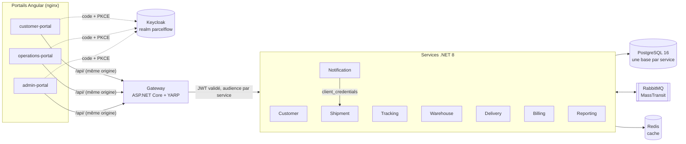

# ParcelFlow

ParcelFlow est une plateforme d'expédition de colis construite en microservices .NET 8 : création d'envois avec devis et étiquette, paiement, entreposage, tournées de livraison, suivi public, facturation, notifications et indicateurs. Trois portails Angular (client, opérations, administration) passent par une API gateway authentifiée par Keycloak. Le dépôt contient aussi la plateforme locale Docker Compose, le chart Helm et la chaîne CI/CD GitHub Actions.

## Sommaire

- [Architecture](#architecture)
- [Organisation du dépôt](#organisation-du-dépôt)
- [Prérequis](#prérequis)
- [Démarrage rapide avec Docker Compose](#démarrage-rapide-avec-docker-compose)
- [Cluster Kubernetes local (minikube)](#cluster-kubernetes-local-minikube)
- [Développement](#développement)
- [Tests](#tests)
- [CI/CD et déploiement](#cicd-et-déploiement)
- [Documentation](#documentation)

## Architecture



| Composant | Responsabilité |
| --- | --- |
| Customer | Profils clients, adresses et entreprises ; Keycloak reste propriétaire des identités |
| Shipment | Envois, devis côté serveur, numéro de suivi, étiquette PDF, tarifs ; saga de réservation et délai de paiement |
| Tracking | Historique des colis et suivi public anonyme |
| Warehouse | Entrepôts et centres de tri, scans d'entrée/sortie, stock courant |
| Delivery | Tournées, affectation des livreurs, preuves de livraison |
| Billing | Factures, paiements simulés, avoirs |
| Notification | Notifications email/SMS simulées (aucun envoi réel) |
| Reporting | Indicateurs : volumes, taux de livraison, délais |
| Gateway | Point d'entrée HTTP unique (YARP) : routage `/api/v1/*`, validation JWT, CORS, limitation de débit |
| Portails | `customer-portal`, `operations-portal`, `admin-portal` (Angular 22, Spartan UI, Tailwind CSS 4) |

Principes structurants :

- **Clean Architecture par service** : `Domain`, `Application` (MediatR, FluentValidation), `Infrastructure` (EF Core, MassTransit), `Api`. Aucun service ne référence un autre service.
- **Socle commun** `src/BuildingBlocks` : contrats d'intégration versionnés (`Contracts/<Service>/V1`), pipeline de validation, ProblemDetails communs, configuration de la messagerie.
- **Événements asynchrones fiables** : Outbox EF Core et inbox MassTransit dans la base de chaque service, livraison au moins une fois avec déduplication.
- **Sécurité** : la gateway exige une audience égale au service ciblé (`customer-api`, `shipment-api`, etc.) ; chaque service contrôle ensuite rôles (`customer`, `operator`, `admin`) et propriété.
- **Observabilité** : Serilog, OpenTelemetry (export OTLP optionnel), métriques Prometheus sur `/metrics`, health checks `/health/live` et `/health/ready`.

### Principaux flux d'événements

| Émetteur | Événement | Consommateurs |
| --- | --- | --- |
| Shipment | `ShipmentCreated` | Tracking, Notification |
| Shipment (saga) | `PaymentRequested` | Billing |
| Billing | `PaymentCompleted`, `PaymentFailed` | Shipment (saga), Notification |
| Billing | `InvoiceIssued`, `CreditNoteIssued` | Notification |
| Shipment | `ShipmentReadyForPickup` | Warehouse, Delivery |
| Warehouse | `ParcelPickedUp` | Tracking, Delivery |
| Warehouse, Delivery | `ParcelStatusRecorded` | Tracking, Warehouse |
| Tracking | `TrackingStatusChanged` | Reporting, Notification |

Les décisions d'architecture notables sont consignées dans [`docs/adr/`](docs/adr/).

## Organisation du dépôt

```text
.
├── ParcelFlow.sln            solution .NET (services, gateway, tests)
├── global.json               SDK .NET 8.0.400, rollForward latestPatch
├── Directory.Build.props     net8.0, C# 12, nullable, warnings as errors
├── docker-compose.yml        plateforme locale complète
├── .env.example              modèle des secrets locaux
├── src/
│   ├── BuildingBlocks/       Contracts, Application, Api, Messaging
│   ├── Services/<Service>/   Domain, Application, Infrastructure, Api (+ Dockerfile)
│   └── Gateway/ParcelFlow.Gateway/
├── tests/
│   ├── BuildingBlocks/       tests du socle
│   ├── Gateway/              tests de la gateway + kestrel-smoke.mjs
│   ├── Services/<Service>/   UnitTests, ContractTests, IntegrationTests
│   └── Shared/               utilitaires partagés (plugin RabbitMQ des tests)
├── frontends/                workspace Angular : shared + 3 portails
├── deploy/
│   ├── helm/parcelflow/      chart Helm
│   ├── kubernetes/           profils de valeurs, scripts minikube, External Secrets
│   ├── keycloak/             realm parcelflow importable
│   ├── migrations/           image des bundles de migration EF Core
│   ├── postgres/             création des bases au premier démarrage
│   └── rabbitmq/             image RabbitMQ avec plugin de messages différés
├── docs/                     documentation par composant et ADR
└── .github/workflows/        ci.yml, deploy.yml
```

## Prérequis

| Outil | Version | Usage |
| --- | --- | --- |
| SDK .NET | **8.0.4xx** (bande 8.0.400 ou correctif ultérieur) | Compilation et tests .NET |
| Docker (Desktop ou Engine) avec Compose v2 | récent | Plateforme locale, tests d'intégration (Testcontainers), images |
| Node.js | 22.12+ ou 24+ (`engines` de `frontends/package.json`) | Portails Angular |
| minikube, kubectl, Helm (3.x ou 4.x ; la CI utilise 4.3) | optionnels | Cluster Kubernetes local |

`global.json` fixe le SDK `8.0.400` avec `rollForward: latestPatch` : seul un SDK de la bande **8.0.4xx** est accepté, et le passage implicite à un SDK 9 ou 10 est refusé. Installer un SDK 8.0.4xx depuis la [page de téléchargement .NET 8](https://dotnet.microsoft.com/download/dotnet/8.0), ou avec le script officiel :

```powershell
# Windows (PowerShell)
Invoke-WebRequest https://dot.net/v1/dotnet-install.ps1 -OutFile dotnet-install.ps1
./dotnet-install.ps1 -Channel 8.0.4xx
```

```bash
# Linux / macOS
curl -sSL https://dot.net/v1/dotnet-install.sh | bash -s -- --channel 8.0.4xx
# The script does not change PATH: add its default install directory (also to the shell profile)
export DOTNET_ROOT="$HOME/.dotnet" PATH="$HOME/.dotnet:$PATH"
```

Vérifier avec `dotnet --version` à la racine du dépôt (attendu : `8.0.4xx`). Un SDK installé localement dans `.dotnet/` (ignoré par Git) peut aussi être utilisé via `./.dotnet/dotnet.exe` (Windows) ou `./.dotnet/dotnet` (Linux / macOS).

## Démarrage rapide avec Docker Compose

```bash
cp .env.example .env          # puis remplacer chaque valeur
docker compose up --build -d
docker compose ps             # PostgreSQL, Redis, RabbitMQ et Keycloak "healthy", les autres conteneurs "running"
```

`.env` n'est pas versionné. Compose refuse de démarrer si `POSTGRES_PASSWORD`, `RABBITMQ_PASSWORD`, `KEYCLOAK_ADMIN_PASSWORD`, `NOTIFICATION_CLIENT_SECRET`, `DELIVERY_PROOF_KEY` ou `DEMO_USER_PASSWORD` manque. `DELIVERY_PROOF_KEY` chiffre les preuves de livraison : remplacer la clé de développement de l'exemple par `openssl rand -base64 32` (32 octets en base64, sinon Delivery refuse de démarrer). `DEMO_USER_PASSWORD` doit respecter la politique du realm (12 caractères minimum, majuscule, minuscule, chiffre et caractère spécial), sinon Keycloak refuse l'import.

| URL | Usage |
| --- | --- |
| http://localhost:4201 | Portail client |
| http://localhost:4202 | Portail opérations |
| http://localhost:4203 | Portail d'administration |
| http://localhost:5100 | Gateway (`/api/v1/...`) |
| http://localhost:8080 | Keycloak (`KEYCLOAK_PORT`, à changer si 8080 est occupé) |
| http://localhost:15672 | Console RabbitMQ |

Les ports sont publiés sur `127.0.0.1` uniquement. En local, les services tournent en `Development` : migrations et données de démonstration sont appliquées au démarrage.

### Comptes de démonstration

Tous les comptes partagent le mot de passe `DEMO_USER_PASSWORD` de `.env`.

| Username | Rôle | Portail |
| --- | --- | --- |
| `emma.martin`, `lucas.bernard` | customer | client (4201) |
| `camille.martin`, `alex.durand` | operator (livreurs) | opérations (4202) |
| `chloe.leroy` | operator | opérations (4202) |
| `admin.parcelflow` | admin | administration (4203), opérations (4202) |

Détails des clients Keycloak, audiences et réinitialisation du realm : [`deploy/keycloak/README.md`](deploy/keycloak/README.md).

### Commandes utiles

| Commande | Effet |
| --- | --- |
| `docker compose logs -f <service>` | Journaux d'un service |
| `docker compose up -d --build <service>` | Reconstruire et redémarrer un service |
| `docker compose up -d --force-recreate keycloak` | Réimporter le realm après modification |
| `docker compose down` | Arrêter en conservant les données |
| `docker compose down -v` | Arrêter et supprimer les volumes PostgreSQL et RabbitMQ |
| `sh deploy/rabbitmq/replay-error-queue.sh parcelflow list` | Files d'erreur MassTransit et leur nombre de messages ; `replay <file>` les relance (voir [docs/demo.md](docs/demo.md#files-derreur-rabbitmq)) |

## Cluster Kubernetes local (minikube)

Le chart `deploy/helm/parcelflow` déploie la même plateforme ; le profil `deploy/kubernetes/values-local.yaml` y ajoute PostgreSQL, Redis, RabbitMQ et Keycloak de développement. Les secrets viennent du même fichier `.env`.

```powershell
docker compose build
./deploy/kubernetes/local.ps1 up -StartCluster   # profil minikube "parcelflow", chargement des images, helm upgrade --install
./deploy/kubernetes/local.ps1 forward            # port-forward ; Ctrl+C pour arrêter, ou -Detach / -Stop
./deploy/kubernetes/local.ps1 down               # -DeleteNamespace supprime les volumes, -StopCluster arrête minikube
```

`deploy/kubernetes/local.sh` offre les mêmes commandes avec des options en `--kebab-case` (`--start-cluster`, `--detach`, etc.). Les scripts utilisent toujours le contexte `parcelflow` (`PARCELFLOW_KUBE_CONTEXT`) et refusent tout contexte qui n'est pas minikube.

Les URL sont celles de Compose, sauf Keycloak sur **http://localhost:8180**.

## Développement

### Backend

```powershell
dotnet restore ParcelFlow.sln
dotnet build ParcelFlow.sln --configuration Release --no-restore
```

Pour exécuter un service hors conteneur (PostgreSQL, RabbitMQ, Redis et Keycloak requis), voir la section d'exécution de chaque `docs/<service>-service.md` (variables `ConnectionStrings__*`, `RabbitMq__*`, `Keycloak__*`, `Database__*`). Les ports locaux proposés vont de 5101 (Customer) à 5108 (Reporting), la gateway sur 5100 ([`docs/gateway.md`](docs/gateway.md)).

L'outil `dotnet-ef` est déclaré dans `.config/dotnet-tools.json` (`dotnet tool restore`).

### Portails Angular

Depuis `frontends/` :

| Commande | Effet |
| --- | --- |
| `npm ci` | Installation |
| `npm run start:customer` (`:operations`, `:admin`) | Portail en mode simulé (API MSW, identités simulées), sans backend |
| `npx ng serve <portail> --configuration gateway` | Portail contre Keycloak et la gateway locale (`localhost:5100`) |

## Tests

| Niveau | Emplacement | Commande |
| --- | --- | --- |
| Unitaires, contrats, BuildingBlocks, Gateway | `tests/**` hors `*.IntegrationTests` | `dotnet test tests/Services/<Service>/ParcelFlow.<Service>.UnitTests` (idem `.ContractTests`, `tests/BuildingBlocks/...`, `tests/Gateway/...`) |
| Intégration (Testcontainers) | `tests/Services/<Service>/ParcelFlow.<Service>.IntegrationTests` | `dotnet test tests/Services/<Service>/ParcelFlow.<Service>.IntegrationTests` — **Docker requis** : PostgreSQL, RabbitMQ et Redis réels démarrés à la volée |
| Tout | solution | `dotnet test ParcelFlow.sln` (inclut les tests d'intégration, donc Docker) |
| Smoke test Kestrel de la gateway | `tests/Gateway/kestrel-smoke.mjs` | `dotnet build src/Gateway/ParcelFlow.Gateway --configuration Debug` puis `node tests/Gateway/kestrel-smoke.mjs` |
| Frontends | `frontends/` | `npm run lint`, `npm test` (Vitest), `npm run build`, `npm run format:check` |

Les tests JWT utilisent des jetons signés localement : aucun serveur Keycloak n'est nécessaire.

## CI/CD et déploiement

Le workflow [`.github/workflows/ci.yml`](.github/workflows/ci.yml) s'exécute sur chaque pull request, sur les push vers `develop` et `main`, et à la demande.

| Job | Contrôle |
| --- | --- |
| Secret scan | gitleaks sur tout l'historique (`.gitleaks.toml`) |
| Build, unit and contract tests | Build Release (warnings as errors), tests hors intégration, dérive des modèles EF Core, packages NuGet vulnérables |
| Integration tests | Matrice des 8 services avec Testcontainers |
| Gateway Kestrel smoke test | `tests/Gateway/kestrel-smoke.mjs` sous Node 22 |
| Frontends | `npm audit`, Prettier, lint, tests, builds de production |
| Dockerfile lint and compose validation | hadolint et `docker compose config` |
| Helm chart lint and schema validation | `helm lint --strict`, `helm template` sur quatre profils, kubeconform |
| Image | Build et scan Trivy de chaque image (gateway, 8 services, 3 portails, RabbitMQ, 8 bundles de migration) ; publication sur GHCR uniquement sur push vers `main` ou `develop` |
| Deploy | Appel de `deploy.yml` après un push réussi |

Images publiées : `ghcr.io/yvahajatiana/parcelflow-<image>`, taguées `sha-<sha court>`, `develop` / `main`, et `latest` sur `main`.

### Déploiement continu

[`.github/workflows/deploy.yml`](.github/workflows/deploy.yml) exécute `helm upgrade --install` avec le tag `sha-<sha court>` des images qui viennent d'être publiées :

- push sur `develop` → environnement GitHub **`staging`** ; push sur `main` → **`production`** (tags de commit immuables uniquement) ;
- les jobs de migration EF Core (hooks Helm `pre-install` / `pre-upgrade`) s'exécutent avant la mise à jour des workloads ;
- `--rollback-on-failure --wait --timeout 15m` : retour automatique à la révision précédente en cas d'échec ;
- lancement manuel possible (Actions → Deploy → Run workflow) pour redéployer ou revenir à un tag antérieur.

Configuration de chaque environnement (Settings → Environments) :

| Nom | Type | Rôle |
| --- | --- | --- |
| `KUBECONFIG` | secret | kubeconfig d'un compte de déploiement limité au namespace |
| `HELM_VALUES` | secret | values de l'environnement, sur le modèle de [`deploy/kubernetes/values-production.example.yaml`](deploy/kubernetes/values-production.example.yaml) |
| `KUBE_CONTEXT` | variable, optionnelle | contexte du kubeconfig |
| `HELM_NAMESPACE` | variable, optionnelle | namespace de la release (`parcelflow` par défaut, doit exister) |
| `HELM_RELEASE` | variable, optionnelle | nom de la release (`parcelflow` par défaut) |

Sans `KUBECONFIG` ni `HELM_VALUES`, le job réussit sans déployer. Les secrets applicatifs ne transitent pas par `HELM_VALUES` : ils viennent d'External Secrets Operator ou d'un Secret existant. Prérequis du cluster de production (Ingress ou Gateway API, cert-manager, RabbitMQ avec `rabbitmq_delayed_message_exchange`, Keycloak HTTPS) : voir [`docs/kubernetes.md`](docs/kubernetes.md#production).

## Documentation

| Document | Contenu |
| --- | --- |
| [Tutoriel : construire ParcelFlow pas à pas](docs/tutorial/README.md) | Construction du projet étape par étape |
| [`docs/monorepo.md`](docs/monorepo.md) | Arborescence et conventions des services |
| [`docs/building-blocks.md`](docs/building-blocks.md) | Socle commun : validation, ProblemDetails, contrats |
| [`docs/customer-service.md`](docs/customer-service.md) | Service Customer |
| [`docs/shipment-service.md`](docs/shipment-service.md) | Service Shipment et saga de réservation |
| [`docs/tracking-service.md`](docs/tracking-service.md) | Service Tracking |
| [`docs/warehouse-service.md`](docs/warehouse-service.md) | Service Warehouse |
| [`docs/delivery-service.md`](docs/delivery-service.md) | Service Delivery |
| [`docs/billing-service.md`](docs/billing-service.md) | Service Billing |
| [`docs/notification-service.md`](docs/notification-service.md) | Service Notification |
| [`docs/reporting-service.md`](docs/reporting-service.md) | Service Reporting |
| [`docs/gateway.md`](docs/gateway.md) | API gateway : routage, authentification, limites |
| [`docs/frontends.md`](docs/frontends.md) | Portails Angular |
| [`docs/docker.md`](docs/docker.md) | Images et plateforme Docker Compose |
| [`docs/kubernetes.md`](docs/kubernetes.md) | Chart Helm, profils, minikube, production |
| [`docs/demo.md`](docs/demo.md) | Démo publique : VPS Hetzner, Dokploy, Cloudflare, réinitialisation nocturne |
| [`docs/ci-cd.md`](docs/ci-cd.md) | Workflows CI/CD et déploiement |
| [`docs/adr/`](docs/adr/) | Décisions d'architecture |
| [`deploy/keycloak/README.md`](deploy/keycloak/README.md) | Realm Keycloak local et comptes de démonstration |
