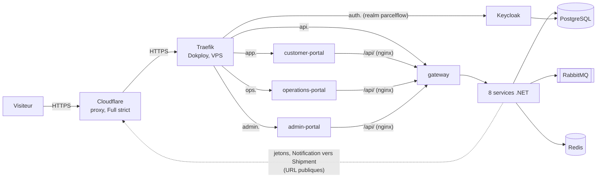

# Démo publique

La démo publique fait tourner toute la plateforme ParcelFlow sur un VPS Hetzner dédié (8 Go de RAM). Le déploiement est piloté par l'instance Dokploy existante, qui gère ce VPS comme *Remote Server*, et le DNS passe par Cloudflare. Les fichiers sont dans `deploy/dokploy/`.

## Architecture



| Hôte | Conteneur | Port interne |
| --- | --- | --- |
| `app.<DEMO_DOMAIN>` | `customer-portal` | 8080 |
| `ops.<DEMO_DOMAIN>` | `operations-portal` | 8080 |
| `admin.<DEMO_DOMAIN>` | `admin-portal` | 8080 |
| `api.<DEMO_DOMAIN>` | `gateway` | 8080 (API seulement) |
| `auth.<DEMO_DOMAIN>` | `keycloak` | 8080, chemins `/realms/parcelflow` et `/resources/` uniquement |

Aucun port n'est publié sur l'hôte. PostgreSQL, Redis, RabbitMQ (et sa console), la console d'administration Keycloak, le realm `master` et le port de management 8081 des conteneurs .NET (`/health/*`, `/metrics`) ne sont pas joignables depuis Internet.

| Fichier | Rôle |
| --- | --- |
| `deploy/dokploy/docker-compose.yml` | Stack de la démo : images GHCR, labels Traefik, limites mémoire, rotation des logs |
| `deploy/dokploy/.env.example` | Toutes les variables, avec des valeurs factices |
| `deploy/dokploy/init-keycloak-database.sh` | Création de la base `keycloak` au premier démarrage du volume PostgreSQL, après `deploy/postgres/init-databases.sh` |
| `deploy/dokploy/keycloak-demo-config.sh` | Adaptation idempotente du realm importé à la démo (service one-shot `keycloak-demo-config`) |
| `deploy/dokploy/reset-demo.sh` | Réinitialisation nocturne, exécutée sur l'hôte |

## Choix

- **Un VPS plutôt que Google Cloud Run.** Les consommateurs MassTransit et la saga Shipment exigent des instances toujours allumées. PostgreSQL, Redis et RabbitMQ demanderaient des services gérés séparés. Le coût dépasserait plusieurs fois celui du VPS, et les démarrages à froid gâcheraient la première impression.
- **Docker Compose plutôt que k3s.** Les valeurs Helm de production (2 répliques) réservent environ 4,7 Go, pour environ 12 Go de plafonds cumulés : trop pour 8 Go. Compose fait tourner une instance de chaque conteneur, avec des plafonds explicites.
- **Remote Server Dokploy.** Le VPS fait tourner son propre Traefik ; les sites existants restent sur l'ancien serveur.
- **Pas de build sur le VPS.** La CI publie déjà les images sur GHCR. Le compose n'a aucune section `build:`, `pull_policy: always` retire les images à chaque déploiement, et le tag est `${PARCELFLOW_TAG:-latest}`. Builder les images .NET et Angular sur 8 Go serait risqué, et le cache de build remplirait le disque.
- **Environnement ASP.NET `Demo`.** Les services tournent en `Demo` : comportement de production (HTTPS exigé vers Keycloak et Shipment, pas de Swagger), avec en plus les migrations et les seeds idempotents au démarrage (`Database__Initialize`, `Database__SeedDemoData`), refusés en `Production`. Cela évite huit images `<service>-migrations` à tirer et à séquencer, et un job de seed séparé. La production Kubernetes garde ses jobs de migration et ne seede jamais. La gateway, sans base, reste en `Production`.
- **Labels Traefik versionnés plutôt que l'onglet Domains.** Les routes sont relues en PR et reproductibles. L'UI ne sait pas restreindre les chemins de `auth.`. Les conteneurs routés rejoignent le réseau externe `dokploy-network`, surveillé par le Traefik de Dokploy. `traefik.docker.network` fixe le réseau à utiliser. Chaque hôte a un routeur `web` (redirection `redirect-to-https@file` de Dokploy) et un routeur `websecure` (certresolver `letsencrypt` de Dokploy).
- **Un seul émetteur, par l'URL publique.** `Keycloak__Authority` vaut `https://auth.<DEMO_DOMAIN>/realms/parcelflow` pour les services et la gateway, et Notification appelle Shipment par `https://api.<DEMO_DOMAIN>/`, car HTTPS est obligatoire hors Development. Ces appels sortent du VPS et reviennent par Cloudflare. Le Bot Fight Mode et les challenges Cloudflare ne doivent donc pas s'appliquer à l'IP du VPS. Ce détour fonctionne quel que soit le certificat d'origine (Let's Encrypt ou Origin CA).
- **Keycloak en mode `start`.** Le realm est importé par `--import-realm` dans la base PostgreSQL `keycloak`, avec le même rôle `parcelflow` que les services. Les autres réglages : `KC_HOSTNAME=https://auth.<DEMO_DOMAIN>`, HTTP actif derrière Traefik, `KC_PROXY_HEADERS=xforwarded`, et un tas JVM borné (`JAVA_OPTS_KC_HEAP`) sous la limite du conteneur. `deploy/keycloak/parcelflow-realm.json` n'est pas modifié : les écarts propres à la démo sont appliqués après l'import.
- **Liste blanche de chemins sur `auth.`.** Traefik ne route que `/realms/parcelflow`, `/realms/parcelflow/` et `/resources/`. `/admin` et `/realms/master` répondent 404 au niveau de Traefik. `KC_HOSTNAME_ADMIN=http://localhost:8180` fait servir la console d'administration à l'adresse du tunnel SSH (voir [Exploitation](#exploitation)).
- **Bandeau de démo par `displayNameHtml`.** `keycloak-demo-config` écrit dans le nom HTML du realm un bandeau en français : comptes `emma.martin` (client), `chloe.leroy` (opérateur), `admin.parcelflow` (administrateur) et mot de passe commun. La page de connexion de chaque portail affiche ainsi les identifiants, sans modifier les frontends. Les valeurs sont échappées en HTML.
- **Protection contre la force brute désactivée.** Les mots de passe sont publics : un verrouillage ne servirait qu'à permettre aux visiteurs de se bloquer entre eux.
- **Pas de libre-service sur les comptes partagés.** `manage-account` et `manage-account-links` sont retirés de `default-roles-parcelflow`, ce qui met la console de compte en lecture seule. Toutes les actions requises sauf `update_user_locale` sont désactivées. Un visiteur ne peut donc ni changer le mot de passe ou le profil, ni ajouter un OTP par une action initiée par l'application (`kc_action`).
- **Identifiants réappliqués à chaque déploiement.** Le realm n'est importé que s'il est absent. Le one-shot redéfinit donc le mot de passe des six comptes de démo (`DEMO_USER_PASSWORD`) et le secret du client `notification-service` (`NOTIFICATION_CLIENT_SECRET`) : changer l'une de ces valeurs puis redéployer suffit, sans reset. `passwordHistory` est retiré de la politique de mots de passe du realm de démo, sinon Keycloak refuserait de réappliquer le même mot de passe.
- **Redirections limitées aux origines de la démo.** Pour les trois clients des portails, les redirect URIs, web origins et `post.logout.redirect.uris` ne gardent que `https://app.`, `https://ops.` ou `https://admin.<DEMO_DOMAIN>`.
- **`keycloak-demo-config` en one-shot.** Il dépend de Keycloak `healthy`. Les portails attendent qu'il se termine avec succès (`service_completed_successfully`), ce qui rend visible un échec de configuration. Il est relancé à chaque déploiement et après chaque réinitialisation.
- **Quotas de la gateway relevés.** Tout le trafic des portails arrive depuis le nginx du portail, et tous les visiteurs partagent les mêmes comptes. Les quotas par adresse et par utilisateur deviennent donc globaux : 300 requêtes publiques, 1 200 privées par utilisateur et 3 000 par adresse, par minute. Ils restent réglables par variable.
- **Healthcheck Keycloak sur le statut HTTP.** Une réponse `/health/ready` DOWN contient quand même `"status": "UP"` pour ses vérifications imbriquées. La sonde contrôle donc la ligne `HTTP/1.1 200`, et `pg_isready` passe par TCP pour ignorer le serveur temporaire des scripts d'initialisation.
- **Fichiers du dépôt montés en lecture seule.** Il s'agit des scripts et du realm. Dokploy reclone le dépôt à chaque déploiement : un conteneur déjà démarré garde l'ancien fichier, mais ces fichiers ne sont lus qu'au démarrage d'un conteneur, et Docker résout à nouveau le chemin à chaque démarrage. Ne pas ajouter de *File Mounts* Dokploy : leur présence fait passer le répertoire du projet à la racine du dépôt, et les chemins relatifs du compose ne seraient plus valides.
- **Redis sans persistance**, borné à 96 Mo en LRU. **PostgreSQL et RabbitMQ** sur volumes nommés.
- **`restart: unless-stopped`** partout sauf pour le one-shot, et **rotation des logs** `json-file` (`max-size: 10m`, `max-file: 3`) par l'ancre `x-logging`.
- **Déclenchement par la CI.** Le job `demo` de `ci.yml` appelle le webhook Dokploy après la publication des images d'un push sur `main`. L'application Dokploy utilise une source **Git** (URL SSH et clé de déploiement), et non l'application GitHub : celle-ci redéploierait dès le push, avant la publication des images.

### Mémoire

Limites `mem_limit` (plafonds cumulés d'environ 5,4 Go sur 8 Go, sans surallocation) :

| Conteneur | Limite | Raison |
| --- | --- | --- |
| 8 services .NET | 320 Mo chacun | GC workstation (`DOTNET_gcServer=0`), environ 90 Mo au repos |
| gateway | 256 Mo | Proxy sans état |
| 3 portails nginx | 64 Mo chacun | Fichiers statiques et proxy `/api/` |
| PostgreSQL | 768 Mo | 9 bases, `shared_buffers` par défaut |
| Redis | 128 Mo | `maxmemory 96mb` |
| RabbitMQ | 512 Mo | Seuil mémoire de RabbitMQ à 60 % de la limite |
| Keycloak | 1 Go | Tas JVM limité à 60 % |
| keycloak-demo-config | 256 Mo | `kcadm.sh` ponctuel |

Mesure locale (Docker Desktop, images `develop`, services en Development, au repos après les seeds) : environ **1,75 Go** au total, dont Keycloak 665 Mo, RabbitMQ 150 Mo, PostgreSQL 110 Mo, 85 à 95 Mo par service .NET, 34 Mo pour la gateway et 13 Mo par portail. Les images occupent environ 3,8 Go sur le disque. La mesure sur le VPS reste à faire et à reporter ici :

```bash
docker stats --no-stream --format 'table {{.Name}}\t{{.MemUsage}}\t{{.CPUPerc}}' \
  $(docker ps -q --filter label=com.docker.compose.project=<appName>)
free -m && df -h / && docker system df
```

## Mise en place

À faire une fois par le propriétaire, dans l'ordre :

1. **VPS Hetzner.** Choisir un type x86 (Intel ou AMD), pas Ampere (ARM), car les images ne sont publiées qu'en `linux/amd64`. Prévoir 8 Go de RAM et Ubuntu LTS. Installer à la création la clé SSH publique générée par Dokploy (Settings, SSH Keys). Activer les sauvegardes ou des snapshots Hetzner. Ajouter un Cloud Firewall Hetzner : 80 et 443 ouverts (idéalement limités aux plages IP Cloudflare), 22 limité à l'IP du serveur Dokploy et à l'IP d'administration. Les ports publiés par Docker contournent `ufw`.
2. **Dokploy, Remote Server.** Dans Servers, ajouter le serveur (IP, port 22, utilisateur `root`, clé SSH), puis lancer *Setup Server* et *Validate*. Le setup installe Docker, crée `dokploy-network` et démarre Traefik. Activer le nettoyage Docker du serveur : chaque déploiement tire de nouvelles images `latest`.
3. **Cloudflare.**
   - Créer 5 enregistrements A **proxifiés** (`app`, `ops`, `admin`, `api`, `auth`) vers l'IP du VPS.
   - Mettre SSL/TLS en **Full (strict)**, et non « Flexible », pour éviter les boucles de redirection avec Traefik.
   - Laisser « Always Use HTTPS » désactivé : le challenge HTTP-01 de Let's Encrypt passe par le port 80 et Traefik redirige lui-même vers HTTPS.
   - Désactiver le Bot Fight Mode, ou exclure l'IP du VPS des challenges par une règle WAF *Skip*.
4. **GHCR.** Le dépôt et ses packages sont privés. Dans Dokploy (Registry), ajouter `ghcr.io` avec le nom d'utilisateur GitHub et un PAT classic limité à `read:packages`, puis tester. À défaut, exécuter `docker login ghcr.io` une fois sur le VPS.
5. **Application Compose.**
   - Créer un projet, puis un service *Compose* de type Docker Compose, sur le serveur de la démo.
   - Source **Git** : `git@github.com:Yvahajatiana/ShippingTracer.git`, branche `main`, clé SSH Dokploy ajoutée comme *deploy key* en lecture seule sur le dépôt.
   - Compose Path : `./deploy/dokploy/docker-compose.yml`.
   - Ne rien déclarer dans Domains, ne pas activer *Isolated Deployments*, n'ajouter aucun File Mount, laisser les Watch Paths vides.
6. **Variables.** Dans l'onglet Environment, saisir toutes les variables de `deploy/dokploy/.env.example` avec de vraies valeurs. `DEMO_USER_PASSWORD` est public, mais doit respecter la politique du realm et ne contenir ni `"` ni `\` : Keycloak le substitue tel quel dans le JSON du realm. Les autres secrets doivent être longs et aléatoires.
7. **Premier déploiement.** Lancer *Deploy* puis suivre les logs. Keycloak importe le realm, `keycloak-demo-config` se termine en `Exited (0)`, et les services migrent puis seedent leurs bases.
8. **Webhook.** Activer *Auto Deploy* (sans lui, le webhook est refusé). Copier l'URL du webhook depuis l'onglet Deployments et l'enregistrer comme secret de dépôt GitHub `DOKPLOY_DEMO_WEBHOOK_URL`. Sans ce secret, le job `demo` réussit avec une notice.
9. **Réinitialisation nocturne.** Créer dans Dokploy une tâche planifiée de type *Server* sur le VPS. On peut aussi utiliser une crontab `root` sur l'hôte. Exemple, chaque nuit à 3 h (heure du serveur) :

   ```bash
   sh /etc/dokploy/compose/<appName>/code/deploy/dokploy/reset-demo.sh <appName>
   ```

   ```cron
   0 3 * * * sh /etc/dokploy/compose/<appName>/code/deploy/dokploy/reset-demo.sh <appName> >> /var/log/parcelflow-reset.log 2>&1
   ```

   `<appName>` est le nom d'application Dokploy, aussi nom du projet Compose (`docker compose ls`).
10. **Supervision externe.** Le monitoring Dokploy ne couvre pas les remote servers, et `/health/ready` n'est plus public (port de management). Créer deux moniteurs HTTP(S) UptimeRobot, toutes les 5 minutes :
    - `https://app.<DEMO_DOMAIN>/api/v1/tracking/PF400000000000000000000001` : colis seedé, suivi anonyme, mot-clé `trackingNumber`. Il traverse nginx du portail, la gateway, Tracking et PostgreSQL.
    - `https://auth.<DEMO_DOMAIN>/realms/parcelflow/.well-known/openid-configuration` : Keycloak et sa base.
11. **Mesure.** Après une journée, relever `docker stats` et `df -h` (voir [Mémoire](#mémoire)) et les noter dans ce document.

## Exploitation

| Action | Procédure |
| --- | --- |
| Mise à jour | Push sur `main` : la CI publie les images puis appelle le webhook. Dokploy reclone, tire `latest` et recrée les conteneurs modifiés. Redéploiement manuel possible par *Deploy*. |
| Retour arrière | Mettre `PARCELFLOW_TAG=sha-xxxxxxx` (tag publié par la CI) dans Environment, puis *Deploy*. Revenir ensuite à `latest`. |
| Réinitialisation manuelle | `sh .../reset-demo.sh <appName>` sur l'hôte (environ 2 minutes). |
| Logs | Onglet Logs de Dokploy, ou `docker logs <appName>-<service>-1`. |
| Console Keycloak | Voir ci-dessous. |
| Console RabbitMQ | Même tunnel vers le port 15672 du conteneur `rabbitmq`. |

### Réinitialisation

`reset-demo.sh` (POSIX sh) retrouve les conteneurs par le label `com.docker.compose.project` et n'a besoin ni du fichier compose ni des variables. Il refuse un nom de projet vide ou invalide et vérifie que tous les conteneurs attendus existent avant d'arrêter quoi que ce soit. Un verrou empêche deux exécutions simultanées. Étapes :

1. Arrêt des portails, de la gateway, des 8 services et de Keycloak.
2. `DROP DATABASE ... WITH (FORCE)` puis `CREATE DATABASE` des 8 bases de services et de `keycloak`.
3. Purge des files RabbitMQ, puis `FLUSHALL` sur Redis.
4. Démarrage de Keycloak, qui réimporte le realm et recrée l'administrateur bootstrap, et attente de l'état `healthy`.
5. Exécution de `keycloak-demo-config` (`docker start -a`).
6. Démarrage des services, qui migrent et seedent, puis de la gateway et des portails. Attente de l'état `healthy` des conteneurs .NET.

En cas d'échec, les conteneurs arrêtés sont redémarrés et `keycloak-demo-config` est relancé, pour que la démo ne reste pas hors ligne. Le code de sortie non nul apparaît dans les logs de la tâche. Les messages différés déjà planifiés (délai de paiement de 30 minutes) peuvent encore arriver après la purge. Ils ne correspondent à aucune saga existante et finissent en file d'erreur.

### Console d'administration Keycloak

Elle n'est pas routée par Traefik. Depuis le poste d'administration :

```bash
# Container IP on the compose network (changes when the container is recreated)
ssh root@<vps> "docker inspect -f '{{range .NetworkSettings.Networks}}{{.IPAddress}} {{end}}' <appName>-keycloak-1"
ssh -N -L 8180:<container IP>:8080 root@<vps>
```

Ouvrir ensuite http://localhost:8180/admin/ et se connecter avec `admin` / `KEYCLOAK_ADMIN_PASSWORD`. `KC_HOSTNAME_ADMIN` doit correspondre au port local (`KEYCLOAK_ADMIN_TUNNEL_PORT`, 8180 par défaut). Pour une opération ponctuelle, `docker exec -it <appName>-keycloak-1 /opt/keycloak/bin/kcadm.sh ...` suffit, sans tunnel.

L'administrateur bootstrap est créé avec la base `keycloak`. Un changement de `KEYCLOAK_ADMIN_PASSWORD` ne s'applique donc qu'après la réinitialisation suivante.

## Vérifications

Critères d'acceptation, à contrôler sur le VPS :

- Les 3 portails et `https://api.<DEMO_DOMAIN>` répondent en HTTPS derrière Cloudflare. `http://` redirige vers `https://`.
- `https://auth.<DEMO_DOMAIN>/admin/` et `https://auth.<DEMO_DOMAIN>/realms/master/` répondent 404. La page de connexion affiche le bandeau des comptes de démo.
- Un envoi créé par `emma.martin` sur le portail client va jusqu'au bout de la saga : facture, paiement, suivi et notifications.
- Après `reboot` du VPS, tous les conteneurs reviennent seuls (`docker ps`), sans relancer le one-shot, dont la configuration est persistée en base.
- `git grep` ne trouve aucun secret, et aucun port autre que ceux de Traefik n'écoute (`ss -tlnp`).
- RAM au repos sous 5 Go et disque utilisé sous 15 Go.

Vérifié localement (Docker Desktop, projet `parcelflow-demo-test`, réseau `dokploy-network` créé pour le test, `DEMO_DOMAIN=demo.test`) :

- `docker compose -f deploy/dokploy/docker-compose.yml config -q` passe avec les variables de `.env.example`, et échoue avec un message explicite si une variable obligatoire manque.
- PostgreSQL crée les 9 bases et Keycloak importe le realm en mode `start`. `keycloak-demo-config` réussit deux fois de suite : la seconde exécution n'a plus d'action requise à désactiver. Clients, bandeau échappé, force brute, rôles par défaut et actions requises sont vérifiés par `kcadm.sh get`. Les autres attributs des clients (PKCE) sont conservés.
- La page de connexion rend le bandeau. Une redirect URI `http://localhost:4201/` est refusée (400). La configuration de la console d'administration annonce `http://localhost:8180`.
- Stack complète avec les images `develop` (services en Development par un override de test, ces images ne connaissant pas encore `Demo`) : 16 conteneurs `healthy`, suivi public du colis seedé par le nginx du portail client (200).
- `reset-demo.sh` remet à zéro une table témoin, une clé Redis et une modification du realm, puis tout redevient `healthy` (environ 2 min 15 s). Le chemin d'échec (délai Keycloak forcé à 0) redémarre les conteneurs et relance la configuration.
- shellcheck sans avertissement sur les trois scripts.

Non vérifié localement : routage Traefik et certificats, Cloudflare, environnement `Demo` (images pas encore publiées), appels HTTPS en épingle par Cloudflare, et consommation réelle sur le VPS.
