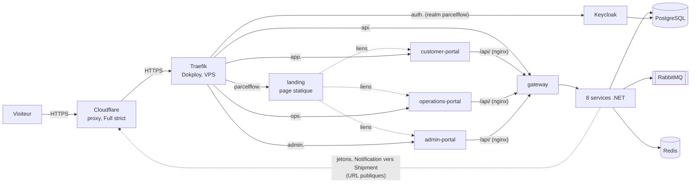
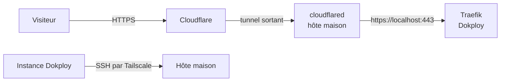

# Démo publique

La démo publique fait tourner toute la plateforme ParcelFlow sur un VPS OVH dédié (VPS-3 : 6 vCPU, 12 Go de RAM, 100 Go de disque, Ubuntu 26.04, Gravelines). Le déploiement est piloté par l'instance Dokploy existante, hébergée sur un autre serveur, qui gère ce VPS comme *Remote Server*. Le DNS passe par Cloudflare. Les fichiers sont dans `deploy/dokploy/` et, pour la page d'accueil, dans `deploy/landing/`. Un autre VPS (Hetzner, IONOS, Hostinger) ou un serveur maison convient aussi : voir [Variantes d'hébergement](#variantes-dhébergement).

## Architecture



| Hôte | Conteneur | Port interne |
| --- | --- | --- |
| `parcelflow.<DEMO_DOMAIN>` | `landing` | 8080 (page d'accueil statique) |
| `app.<DEMO_DOMAIN>` | `customer-portal` | 8080 |
| `ops.<DEMO_DOMAIN>` | `operations-portal` | 8080 |
| `admin.<DEMO_DOMAIN>` | `admin-portal` | 8080 |
| `api.<DEMO_DOMAIN>` | `gateway` | 8080 (API seulement) |
| `auth.<DEMO_DOMAIN>` | `keycloak` | 8080, chemins `/realms/parcelflow` et `/resources/` uniquement |

Aucun port n'est publié sur l'hôte. PostgreSQL, Redis, RabbitMQ (et sa console), la console d'administration Keycloak, le realm `master` et le port de management 8081 des conteneurs .NET (`/health/*`, `/metrics`) ne sont pas joignables depuis Internet.

| Fichier | Rôle |
| --- | --- |
| `deploy/dokploy/docker-compose.yml` | Stack de la démo : images GHCR, labels Traefik, limites mémoire, rotation des logs |
| `deploy/dokploy/.env.example` | Toutes les variables, avec des valeurs factices |
| `deploy/dokploy/init-keycloak-database.sh` | Création de la base `keycloak` au premier démarrage du volume PostgreSQL, après `deploy/postgres/init-databases.sh` |
| `deploy/dokploy/keycloak-demo-config.sh` | Adaptation idempotente du realm importé à la démo (service one-shot `keycloak-demo-config`) |
| `deploy/dokploy/reset-demo.sh` | Réinitialisation nocturne, exécutée sur l'hôte |
| `deploy/landing/Dockerfile` | Image `parcelflow-landing` (nginx) publiée par la CI : la page et sa configuration y sont copiées, aucun fichier du dépôt n'est monté. Dokploy supprime et reclone le dépôt à chaque déploiement ; un montage du dossier vidait la page d'un conteneur non recréé. |
| `deploy/landing/site/` | Page d'accueil statique (HTML, CSS, favicon), avec le marqueur `__DEMO_DOMAIN__` dans les liens |
| `deploy/landing/nginx.conf.template` | Configuration nginx de la page : remplacement du marqueur, CSP stricte, `/healthz`, cache de 5 minutes |

## Choix

- **Un VPS plutôt que Google Cloud Run.** Les consommateurs MassTransit et la saga Shipment exigent des instances toujours allumées. PostgreSQL, Redis et RabbitMQ demanderaient des services gérés séparés. Le coût dépasserait plusieurs fois celui du VPS, et les démarrages à froid gâcheraient la première impression.
- **Docker Compose plutôt que k3s.** Les valeurs Helm de production (2 répliques) réservent environ 4,7 Go, pour environ 12 Go de plafonds cumulés : autant que toute la RAM du VPS (12 Go). Compose fait tourner une instance de chaque conteneur, avec des plafonds explicites.
- **Remote Server Dokploy.** Le VPS fait tourner son propre Traefik ; les sites existants restent sur l'ancien serveur.
- **Page d'accueil statique sur `parcelflow.`.** Elle présente la démo, renvoie vers les trois portails et donne les comptes, sans le mot de passe, qui reste sur le bandeau de la page de connexion. Elle est servie par l'image `nginxinc/nginx-unprivileged` (port 8080, comme les autres conteneurs), avec les fichiers du dépôt montés en lecture seule : aucune image à construire. Le script d'entrée de l'image rend `nginx.conf.template` par `envsubst`, et `sub_filter` remplace `__DEMO_DOMAIN__` par `DEMO_DOMAIN` au moment de servir le HTML. La CSP part de `default-src 'none'` : ni script, ni police, ni ressource externe. Le service n'a aucun `depends_on` et aucun état : la page reste en ligne pendant un redéploiement ou une réinitialisation, que `reset-demo.sh` ne lui applique pas.
- **Pas de build sur le VPS.** La CI publie déjà les images sur GHCR. Le compose n'a aucune section `build:`, `pull_policy: always` retire les images à chaque déploiement, et le tag est `${PARCELFLOW_TAG:-latest}`. Builder les images .NET et Angular sur le VPS de la démo serait risqué, et le cache de build remplirait le disque.
- **Environnement ASP.NET `Demo`.** Les services tournent en `Demo` : comportement de production (HTTPS exigé vers Keycloak et Shipment, pas de Swagger), avec en plus les migrations et les seeds idempotents au démarrage (`Database__Initialize`, `Database__SeedDemoData`), refusés en `Production`. Cela évite huit images `<service>-migrations` à tirer et à séquencer, et un job de seed séparé. La production Kubernetes garde ses jobs de migration et ne seede jamais. La gateway, sans base, reste en `Production`.
- **Labels Traefik versionnés plutôt que l'onglet Domains.** Les routes sont relues en PR et reproductibles. L'UI ne sait pas restreindre les chemins de `auth.`. Les conteneurs routés rejoignent le réseau externe `dokploy-network`, surveillé par le Traefik de Dokploy. `traefik.docker.network` fixe le réseau à utiliser. Chaque hôte a un routeur `web` (redirection `redirect-to-https@file` de Dokploy) et un routeur `websecure` (certresolver `letsencrypt` de Dokploy).
- **Un seul émetteur, par l'URL publique.** `Keycloak__Authority` vaut `https://auth.<DEMO_DOMAIN>/realms/parcelflow` pour les services et la gateway, et Notification appelle Shipment par `https://api.<DEMO_DOMAIN>/`, car HTTPS est obligatoire hors Development. Ces appels sortent du VPS et reviennent par Cloudflare. Le Bot Fight Mode et les challenges Cloudflare ne doivent donc pas s'appliquer à l'IP du VPS. Ce détour fonctionne quel que soit le certificat d'origine (Let's Encrypt ou Origin CA).
- **Keycloak en mode `start`.** Le realm est importé par `--import-realm` dans la base PostgreSQL `keycloak`, avec le même rôle `parcelflow` que les services. Les autres réglages : `KC_HOSTNAME=https://auth.<DEMO_DOMAIN>`, HTTP actif derrière Traefik, `KC_PROXY_HEADERS=xforwarded`, et un tas JVM borné (`JAVA_OPTS_KC_HEAP`) sous la limite du conteneur. `deploy/keycloak/parcelflow-realm.json` n'est pas modifié : les écarts propres à la démo sont appliqués après l'import.
- **Liste blanche de chemins sur `auth.`.** Traefik ne route que `/realms/parcelflow`, `/realms/parcelflow/` et `/resources/`. `/admin` et `/realms/master` répondent 404 au niveau de Traefik. `KC_HOSTNAME_ADMIN=http://localhost:8180` fait servir la console d'administration à l'adresse du tunnel SSH (voir [Exploitation](#exploitation)).
- **Bandeau de démo par `displayNameHtml`.** `keycloak-demo-config` écrit dans le nom HTML du realm un bandeau en français : comptes `emma.martin` (client), `chloe.leroy` (opérateur), `admin.parcelflow` (administrateur) et mot de passe commun. La page de connexion de chaque portail affiche ainsi les identifiants, sans modifier les frontends. Les valeurs sont échappées en HTML.
- **Protection contre la force brute désactivée.** Les mots de passe sont publics : un verrouillage ne servirait qu'à permettre aux visiteurs de se bloquer entre eux.
- **Pas de libre-service sur les comptes partagés.** `manage-account` et `manage-account-links` sont retirés de `default-roles-parcelflow`, ce qui met la console de compte en lecture seule. Toutes les actions requises sauf `update_user_locale` sont désactivées. Un visiteur ne peut donc ni changer le mot de passe ou le profil, ni ajouter un OTP par une action initiée par l'application (`kc_action`).
- **Identifiants réappliqués à chaque déploiement.** Le realm n'est importé que s'il est absent. Le one-shot redéfinit donc le mot de passe des six comptes de démo (`DEMO_USER_PASSWORD`) et le secret du client `notification-service` (`NOTIFICATION_CLIENT_SECRET`) : changer l'une de ces valeurs puis redéployer suffit, sans reset. `passwordHistory` est retiré de la politique de mots de passe du realm de démo, sinon Keycloak refuserait de réappliquer le même mot de passe.
- **Redirections limitées aux origines de la démo.** Pour les trois clients des portails, les redirect URIs, web origins et `post.logout.redirect.uris` ne gardent que `https://app.`, `https://ops.` ou `https://admin.<DEMO_DOMAIN>`.
- **`keycloak-demo-config` en one-shot.** Il dépend de Keycloak `healthy`. Les portails attendent qu'il se termine avec succès (`service_completed_successfully`), ce qui rend visible un échec de configuration. Il est relancé à chaque déploiement et après chaque réinitialisation.
- **Quotas de la gateway relevés.** Tout le trafic des portails arrive depuis le nginx du portail, et tous les visiteurs partagent les mêmes comptes. Les quotas par adresse et par utilisateur deviennent donc globaux : 300 requêtes publiques, 1 200 privées par utilisateur et 3 000 par adresse, par minute. Ils restent réglables par variable.
- **Healthcheck Keycloak sur le statut HTTP.** Une réponse `/health/ready` DOWN contient quand même `"status": "UP"` pour ses vérifications imbriquées. La sonde contrôle donc la ligne `HTTP/1.1 200`, et `pg_isready` passe par TCP pour ignorer le serveur temporaire des scripts d'initialisation.
- **Fichiers du dépôt montés en lecture seule.** Il s'agit des scripts et du realm. Dokploy reclone le dépôt à chaque déploiement : un conteneur déjà démarré garde l'ancien fichier, mais ces fichiers ne sont lus qu'au démarrage d'un conteneur, et Docker résout à nouveau le chemin à chaque démarrage. Ne pas ajouter de *File Mounts* Dokploy : leur présence fait passer le répertoire du projet à la racine du dépôt, et les chemins relatifs du compose ne seraient plus valides.
- **Redis sans persistance**, borné à 96 Mo en LRU. **PostgreSQL et RabbitMQ** sur volumes nommés.
- **`restart: unless-stopped`** partout sauf pour le one-shot, et **rotation des logs** `json-file` (`max-size: 10m`, `max-file: 3`) par l'ancre `x-logging`.
- **Déclenchement par la CI.** Le job `demo` de `ci.yml` appelle le webhook Dokploy après la publication des images d'un push sur `main`. L'application Dokploy utilise une source **Git** (URL SSH et clé de déploiement), et non l'application GitHub : celle-ci redéploierait dès le push, avant la publication des images.

### Mémoire

Limites `mem_limit` (plafonds cumulés d'environ 5,5 Go sur 12 Go, sans surallocation) :

| Conteneur | Limite | Raison |
| --- | --- | --- |
| 8 services .NET | 320 Mo chacun | GC workstation (`DOTNET_gcServer=0`), environ 90 Mo au repos |
| gateway | 256 Mo | Proxy sans état |
| 3 portails nginx | 64 Mo chacun | Fichiers statiques et proxy `/api/` |
| landing | 32 Mo | nginx, trois fichiers statiques |
| backup | 128 Mo | `pg_dump` quotidien, en veille le reste du temps |
| PostgreSQL | 768 Mo | 9 bases, `shared_buffers` par défaut |
| Redis | 128 Mo | `maxmemory 96mb` |
| RabbitMQ | 512 Mo | Seuil mémoire de RabbitMQ à 60 % de la limite |
| Keycloak | 1 Go | Tas JVM limité à 60 % |
| keycloak-demo-config | 256 Mo | `kcadm.sh` ponctuel |

Mesure locale (Docker Desktop, images `develop`, services en Development, au repos après les seeds) : environ **1,75 Go** au total, dont Keycloak 665 Mo, RabbitMQ 150 Mo, PostgreSQL 110 Mo, 85 à 95 Mo par service .NET, 34 Mo pour la gateway et 13 Mo par portail. Les images occupent environ 3,8 Go sur le disque. La mesure sur le VPS reste à faire et à reporter ici :

```bash
docker stats --no-stream --format 'table {{.Name}}\t{{.MemUsage}}\t{{.CPUPerc}}' \
  $(docker ps -q --filter label=com.docker.compose.project=<appName>)
free -m && df -h / && docker system df
```

## Mise en place

À faire une fois par le propriétaire, dans l'ordre :

1. **VPS OVH.** Un VPS-3 OVH à Gravelines : x86_64 (les images ne sont publiées qu'en `linux/amd64`), 6 vCPU, 12 Go de RAM, 100 Go de disque, Ubuntu 26.04. Le login `root` est désactivé : l'administration et Dokploy passent par l'utilisateur `ubuntu` (sudo sans mot de passe, membre du groupe `docker`). Les sauvegardes et snapshots sont ceux d'OVH. Le pare-feu est sur l'hôte, et non chez l'hébergeur (l'Edge Network Firewall d'OVH n'est pas utilisé) :
   - **UFW avec `ufw-docker`.** Les règles passent par la chaîne `DOCKER-USER` : un port publié par Docker reste bloqué sans règle `ufw route allow`, et seuls 80 et 443 (ceux de Traefik) sont routables. Le compose ne publie aucun port (`ports:`) et ne doit pas en publier : seuls les conteneurs routés par les labels Traefik sont joignables.
   - **80 et 443** (TCP, plus 443/UDP pour HTTP/3) ne sont ouverts qu'aux [plages IP Cloudflare](https://www.cloudflare.com/ips/), rafraîchies chaque semaine par un timer systemd. Les enregistrements DNS doivent donc être proxifiés (étape 3).
   - **22** : authentification par clé uniquement, limitation de débit UFW et fail2ban. L'IP du serveur Dokploy est en liste blanche, pour que fail2ban ne la bannisse pas. Le port n'est pas limité à l'IP d'administration, qui est dynamique.

   Pour un autre hébergeur ou un serveur maison, les étapes 1 à 3 changent : voir [Variantes d'hébergement](#variantes-dhébergement).
2. **Dokploy, Remote Server.** Dans Servers, ajouter le serveur (IP, port 22, utilisateur `ubuntu`, clé SSH), puis lancer *Setup Server* et *Validate*. Le setup installe Docker (en mode Swarm), crée `dokploy-network` et démarre Traefik, avec le middleware `redirect-to-https@file` et le resolver `letsencrypt` (challenge HTTP sur l'entrypoint `web`). Activer le nettoyage Docker du serveur : chaque déploiement tire de nouvelles images `latest`.
   - Remplacer l'adresse ACME par défaut (`test@localhost.com`) par une vraie adresse dans la configuration Traefik du serveur (`certificatesResolvers.letsencrypt.acme.email`), depuis Dokploy ou dans `/etc/dokploy/traefik/traefik.yml`, puis redémarrer Traefik. À faire avant le premier déploiement : Let's Encrypt peut refuser une adresse factice, et aucun certificat ne serait émis.
3. **Cloudflare.**
   - Créer 6 enregistrements A **proxifiés** (nuage orange : `parcelflow`, `app`, `ops`, `admin`, `api`, `auth`) vers l'IP du VPS. Le pare-feu n'accepte 80 et 443 que depuis Cloudflare : un enregistrement non proxifié pointerait vers un hôte injoignable.
   - Mettre SSL/TLS en **Full (strict)**, et non « Flexible », pour éviter les boucles de redirection avec Traefik.
   - Laisser « Always Use HTTPS » désactivé : le challenge HTTP-01 de Let's Encrypt passe par le port 80 et Traefik redirige lui-même vers HTTPS.
   - Désactiver le Bot Fight Mode, ou exclure l'IP du VPS des challenges par une règle WAF *Skip*.
4. **GHCR.** Le dépôt et ses packages sont privés. Dans Dokploy (Registry), ajouter `ghcr.io` avec le nom d'utilisateur GitHub et un PAT classic limité à `read:packages`, puis tester. À défaut, exécuter `docker login ghcr.io` une fois sur le VPS.
5. **Application Compose.**
   - Créer un projet, puis un service *Compose* de type Docker Compose, sur le serveur de la démo.
   - Source **Git** : `git@github.com:Yvahajatiana/ShippingTracer.git`, branche `main`. Générer dans Dokploy (Settings, SSH Keys) une clé **dédiée au dépôt**, distincte de celle qui pilote le serveur, et l'ajouter comme *deploy key* en lecture seule sur le dépôt. Une fuite de l'une ne donne ainsi pas accès à l'autre.
   - Compose Path : `./deploy/dokploy/docker-compose.yml`.
   - Ne rien déclarer dans Domains, ne pas activer *Isolated Deployments*, n'ajouter aucun File Mount, laisser les Watch Paths vides.
6. **Variables.** Dans l'onglet Environment, saisir toutes les variables de `deploy/dokploy/.env.example` avec de vraies valeurs. `DEMO_USER_PASSWORD` est public, mais doit respecter la politique du realm et ne contenir ni `"` ni `\` : Keycloak le substitue tel quel dans le JSON du realm. Les autres secrets doivent être longs et aléatoires.
   - `DELIVERY_PROOF_KEY` est la clé AES-256-GCM qui chiffre les preuves de livraison (nom du destinataire, signature, photo) : la base64 de 32 octets aléatoires exactement, générée par `openssl rand -base64 32`. Elle est obligatoire : Compose s'arrête si elle manque et le service Delivery refuse de démarrer avec une valeur invalide, comme le placeholder de l'exemple. **Une démo déjà en ligne doit recevoir cette variable dans Environment avant le déploiement de la version qui chiffre les preuves**, sinon le webhook de `main` déploie un Delivery qui ne démarre pas.
   - `DELIVERY_PROOF_PREVIOUS_KEYS` (optionnelle) liste, séparées par des virgules, les anciennes clés encore acceptées en déchiffrement. `DELIVERY_PROOF_RETENTION_DAYS` (optionnelle, 90 par défaut) fixe la durée de conservation des preuves avant purge.
7. **Premier déploiement.** Lancer *Deploy* puis suivre les logs. Keycloak importe le realm, `keycloak-demo-config` se termine en `Exited (0)`, et les services migrent puis seedent leurs bases. Cloudflare peut répondre **526** pendant quelques minutes : tant que Let's Encrypt n'a pas émis les certificats, Traefik sert son certificat auto-signé par défaut, refusé en Full (strict). Si l'erreur persiste, lire les logs du conteneur Traefik (échecs ACME).
8. **Webhook.** Activer *Auto Deploy* (sans lui, le webhook est refusé). Copier l'URL du webhook depuis l'onglet Deployments et l'enregistrer comme secret de dépôt GitHub `DOKPLOY_DEMO_WEBHOOK_URL`. Sans ce secret, le job `demo` réussit avec une notice.
9. **Réinitialisation nocturne.** Créer dans Dokploy une tâche planifiée de type *Server* sur le VPS. Elle s'exécute en `ubuntu`, dont le groupe `docker` suffit, sans `sudo`. On peut aussi utiliser la crontab de `ubuntu` (`crontab -e`, pas `sudo crontab -e`). Exemple, chaque nuit à 3 h (heure du serveur). La page d'accueil annonce « vers 3 h, heure de Paris » : vérifier le fuseau du serveur (`timedatectl`) et décaler l'heure de la tâche s'il est en UTC, ou ajuster la page.

   ```bash
   sh /etc/dokploy/compose/<appName>/code/deploy/dokploy/reset-demo.sh <appName>
   ```

   ```cron
   0 3 * * * sh /etc/dokploy/compose/<appName>/code/deploy/dokploy/reset-demo.sh <appName> >> /home/ubuntu/parcelflow-reset.log 2>&1
   ```

   `<appName>` est le nom d'application Dokploy, aussi nom du projet Compose (`docker compose ls`). Le script n'a besoin que de l'accès à Docker et n'écrit que son verrou dans `${TMPDIR:-/tmp}` : le journal doit donc aller dans un fichier que `ubuntu` peut écrire, et non dans `/var/log`. Il ne touche pas au conteneur `landing`, sans état.
10. **Supervision externe.** Le monitoring Dokploy ne couvre pas les remote servers, et `/health/ready` n'est plus public (port de management). Créer deux moniteurs HTTP(S) UptimeRobot, toutes les 5 minutes :
    - `https://app.<DEMO_DOMAIN>/api/v1/tracking/PF400000000000000000000001` : colis seedé, suivi anonyme, mot-clé `trackingNumber`. Il traverse nginx du portail, la gateway, Tracking et PostgreSQL.
    - `https://auth.<DEMO_DOMAIN>/realms/parcelflow/.well-known/openid-configuration` : Keycloak et sa base.
11. **Mesure.** Après une journée, relever `docker stats` et `df -h` (voir [Mémoire](#mémoire)) et les noter dans ce document.

## Variantes d'hébergement

Le compose, les scripts et la CI ne dépendent pas de l'hébergeur. Seules les étapes 1 à 3 de la [mise en place](#mise-en-place) changent. Prérequis communs : x86_64 (les images ne sont publiées qu'en `linux/amd64`), 8 Go de RAM au minimum, environ 40 Go de disque, Ubuntu LTS nu, sans panneau d'hébergement (Plesk, cPanel, etc.) qui occuperait les ports 80 et 443.

### VPS Hetzner

Plan initial de la démo. Choisir un type x86 (Intel ou AMD), pas Ampere (ARM). Prévoir 8 Go de RAM et Ubuntu LTS. Installer à la création la clé SSH publique générée par Dokploy (Settings, SSH Keys), pour `root`. Activer les sauvegardes ou des snapshots Hetzner. Ajouter un Cloud Firewall Hetzner : 80 et 443 ouverts (idéalement limités aux plages IP Cloudflare), 22 limité à l'IP du serveur Dokploy et à l'IP d'administration. Les ports publiés par Docker contournent `ufw`, mais pas le Cloud Firewall, qui filtre en amont de la machine. Étapes 2 et 3 inchangées, avec l'utilisateur `root` à l'étape 2.

### VPS IONOS ou Hostinger

Même schéma que la démo : Cloudflare proxifie vers l'IP publique du VPS, et Traefik obtient ses certificats Let's Encrypt.

1. **VPS.** Choisir une offre x86 de 8 Go avec l'image Ubuntu LTS standard, sans application préinstallée. Ajouter à la création la clé SSH publique générée par Dokploy, sinon la copier ensuite dans `/root/.ssh/authorized_keys`. Activer les sauvegardes ou les snapshots si l'offre en propose.
2. **Pare-feu.** Utiliser le pare-feu du panneau de l'hébergeur (IONOS et Hostinger en proposent un pour leurs VPS) avec les mêmes règles qu'un Cloud Firewall Hetzner : 80 et 443 ouverts (idéalement limités aux [plages IP Cloudflare](https://www.cloudflare.com/ips/)), 22 limité à l'IP du serveur Dokploy et à l'IP d'administration. Si le panneau ne sait pas filtrer par IP source :
   - `ufw` suffit pour le port 22, qui n'est pas publié par Docker ;
   - pour 80 et 443, publiés par le Traefik de Dokploy, `ufw` seul est contourné : appliquer `ufw-docker`, qui filtre dans la chaîne `DOCKER-USER` d'iptables, comme sur le VPS OVH de la démo (étape 1). À défaut, laisser 80 et 443 ouverts à tous : seul Traefik écoute, et les routes de la démo sont de toute façon publiques. Le [tunnel Cloudflare](#serveur-maison) supprime ce besoin, et fonctionne aussi sur un VPS.
3. **Dokploy et Cloudflare.** Étapes 2 et 3 inchangées. Si l'IP publique du VPS change (rare, mais possible après une migration chez certains hébergeurs), mettre à jour les 6 enregistrements A.

### Serveur maison

Une machine à domicile n'a en général ni IP fixe, ni ports ouverts (box, parfois CGNAT), et son IP ne doit pas être exposée. Le schéma change donc :

- **Cloudflare Tunnel** au lieu d'enregistrements A : `cloudflared` ouvre une connexion sortante vers Cloudflare, aucun port n'est ouvert sur la box et l'IP du domicile reste cachée.
- **Tailscale** (ou WireGuard) pour que l'instance Dokploy, et l'administrateur, joignent le SSH du serveur sans l'exposer.



1. **Machine.** PC ou mini-PC x86_64, 8 Go de RAM minimum, Ubuntu Server LTS, de préférence en Ethernet. Dans le BIOS, activer le redémarrage automatique après une coupure de courant. Désactiver la mise en veille. Vérifier que les conditions de l'abonnement Internet autorisent l'hébergement.
2. **Accès SSH par Tailscale.** Installer Tailscale sur l'hôte maison et sur le serveur Dokploy, et les joindre au même tailnet. N'ouvrir aucun port sur la box. Dans Dokploy (étape 2), déclarer le serveur avec son **IP Tailscale** (`100.x.y.z`). Les commandes SSH de la section [Exploitation](#exploitation) passent aussi par cette IP.
3. **Dokploy.** Étape 2 inchangée : *Setup Server* installe Docker et Traefik, qui publie 80 et 443 sur l'hôte. Ces ports ne sont joignables que depuis le réseau local, puisque la box ne les redirige pas.
4. **Cloudflare Tunnel**, à la place de l'étape 3 :
   - Dans Cloudflare Zero Trust (Networks, Tunnels), créer un tunnel géré à distance, puis installer `cloudflared` sur l'hôte comme service systemd, avec la commande fournie (`cloudflared service install <token>`). Il tourne sur l'hôte, hors du compose, et survit aux redéploiements.
   - Ajouter 6 *Public Hostnames* (`parcelflow`, `app`, `ops`, `admin`, `api`, `auth`), tous vers le service `https://localhost:443`, avec l'option **No TLS Verify** activée. Cloudflare crée lui-même les enregistrements CNAME : ne pas créer d'enregistrements A.
   - Ne pas viser `http://localhost:80` : le routeur `web` de Traefik redirige vers HTTPS, ce qui ferait boucler les requêtes venues du tunnel.
   - Le challenge HTTP-01 de Let's Encrypt n'aboutit pas derrière le tunnel : Traefik sert son certificat par défaut, accepté grâce à *No TLS Verify*, et journalise des échecs ACME sans conséquence. Le lien entre Cloudflare et `cloudflared` reste chiffré et authentifié. Pour un certificat d'origine valide, charger un certificat Cloudflare Origin CA dans Traefik.
   - Le mode SSL/TLS de la zone ne s'applique pas au tunnel. Désactiver le Bot Fight Mode : les appels des services vers `auth.` et `api.` sortent par l'IP publique du domicile, qui peut changer, et une règle WAF *Skip* par IP ne tiendrait pas.
5. **Suite.** Étapes 4 à 11 inchangées. Les moniteurs UptimeRobot détectent aussi les coupures de courant ou d'Internet au domicile.

Vérifications propres à cette variante : `ss -tlnp` ne montre que Traefik (80, 443), SSH et Tailscale ; depuis un réseau extérieur, l'IP publique du domicile ne répond sur aucun port ; après une coupure de courant, la machine redémarre et `cloudflared`, Tailscale et les conteneurs reviennent seuls.

## Exploitation

| Action | Procédure |
| --- | --- |
| Mise à jour | Push sur `main` : la CI publie les images puis appelle le webhook. Dokploy reclone, tire `latest` et recrée les conteneurs modifiés. Redéploiement manuel possible par *Deploy*. |
| Retour arrière | Mettre `PARCELFLOW_TAG=sha-xxxxxxx` (tag publié par la CI) dans Environment, puis *Deploy*. Revenir ensuite à `latest`. |
| Réinitialisation manuelle | `sh .../reset-demo.sh <appName>` sur l'hôte (environ 2 minutes). |
| Logs | Onglet Logs de Dokploy, ou `docker logs <appName>-<service>-1`. |
| Console Keycloak | Voir ci-dessous. |
| Console RabbitMQ | Même tunnel vers le port 15672 du conteneur `rabbitmq`. |
| Sauvegarde et restauration | Voir [Sauvegardes](#sauvegardes). |
| Rotation de la clé des preuves | Dans Environment, ajouter l'actuelle `DELIVERY_PROOF_KEY` à `DELIVERY_PROOF_PREVIOUS_KEYS`, mettre une nouvelle clé (`openssl rand -base64 32`) dans `DELIVERY_PROOF_KEY`, puis *Deploy*. Retirer l'ancienne clé une fois les preuves qu'elle chiffre purgées (rétention ou réinitialisation nocturne, qui recrée la base Delivery). Une clé retirée trop tôt rend ses preuves illisibles. |

### Réinitialisation

`reset-demo.sh` (POSIX sh) retrouve les conteneurs par le label `com.docker.compose.project` et n'a besoin ni du fichier compose ni des variables. Il refuse un nom de projet vide ou invalide et vérifie que tous les conteneurs attendus existent avant d'arrêter quoi que ce soit. Un verrou empêche deux exécutions simultanées. Étapes :

1. Arrêt des portails, de la gateway, des 8 services et de Keycloak.
2. `DROP DATABASE ... WITH (FORCE)` puis `CREATE DATABASE` des 8 bases de services et de `keycloak`.
3. Purge des files RabbitMQ, puis `FLUSHALL` sur Redis.
4. Démarrage de Keycloak, qui réimporte le realm et recrée l'administrateur bootstrap, et attente de l'état `healthy`.
5. Exécution de `keycloak-demo-config` (`docker start -a`).
6. Démarrage des services, qui migrent et seedent, puis de la gateway et des portails. Attente de l'état `healthy` des conteneurs .NET.

En cas d'échec, les conteneurs arrêtés sont redémarrés et `keycloak-demo-config` est relancé, pour que la démo ne reste pas hors ligne. Le code de sortie non nul apparaît dans les logs de la tâche. Les messages différés déjà planifiés (délai de paiement de 30 minutes) peuvent encore arriver après la purge. Ils ne correspondent à aucune saga existante et finissent en file d'erreur.

### Sauvegardes

Le conteneur `backup` (image `parcelflow-backup`, `deploy/pg-backup/`) fait chaque jour à `BACKUP_TIME` (UTC, 01:30 par défaut) un `pg_dump` au format custom des 8 bases de services et de la base `keycloak`. Celle-ci contient le realm, les utilisateurs et les clients. Les snapshots vont dans le volume `backups` du VPS, un dossier `<horodatage UTC>` par jour avec un manifeste `SHA256SUMS`, et sont gardés `BACKUP_RETENTION_DAYS` jours (7 par défaut). Un snapshot est écrit sous un nom `.partial` puis renommé : une sauvegarde interrompue ne passe jamais pour valide. La sauvegarde doit passer **avant** la réinitialisation nocturne (3 h, heure du serveur), sinon elle ne contient que la démo remise à zéro.

| Objectif | Valeur pour la démo |
| --- | --- |
| RPO (perte de données maximale) | 24 heures : une sauvegarde par jour |
| RTO (durée de restauration) | Environ 2 minutes, mesuré : 117 s pour les 9 bases, arrêt et redémarrage de la stack compris |

Depuis le répertoire du dépôt cloné par Dokploy sur l'hôte :

```bash
sh deploy/dokploy/restore-demo.sh <appName> list       # snapshots disponibles
docker exec <appName>-backup-1 parcelflow-backup now   # sauvegarde immédiate (avant une opération risquée)
sh deploy/dokploy/restore-demo.sh <appName> latest     # ou un snapshot précis, par exemple 2026-11-18T013000Z
```

La restauration arrête les portails, la gateway, les services et Keycloak. Elle vérifie ensuite les sommes de contrôle, recrée puis restaure les 9 bases, purge les files RabbitMQ et vide Redis. Enfin, elle redémarre Keycloak, réapplique `keycloak-demo-config`, puis relance les services et affiche la durée totale. Elle partage le verrou de `reset-demo.sh` : les deux ne peuvent pas tourner en même temps.

**Cohérence entre services.** Toutes les bases reviennent du même snapshot. Les services se transmettent leurs faits par Outbox et Inbox, et la saga de réservation, les factures et le suivi se répondent. Restaurer une seule base la mettrait en retard sur les autres : par exemple, Billing ignorerait une facture que Notification a déjà annoncée, et les événements déjà livrés ne seraient pas republiés. Pour la même raison, la purge de RabbitMQ retire les messages plus récents que le snapshot, et Redis est vidé pour ne pas servir de lectures en cache. `parcelflow-restore <snapshot> <base>` permet de restaurer une base seule, mais à réserver à un diagnostic.

**Hors des sauvegardes.** Les variables d'environnement Dokploy (mots de passe, `DELIVERY_PROOF_KEY`) ne sont pas dans les dumps : en garder une copie hors du VPS, dans un gestionnaire de mots de passe. Sans `DELIVERY_PROOF_KEY`, les preuves de livraison restaurées restent illisibles. Les snapshots restent sur le VPS : la perte du serveur emporte aussi ses sauvegardes. Pour une copie ponctuelle :

```bash
docker cp <appName>-backup-1:/backups/<snapshot> ./parcelflow-<snapshot>
```

Exercice réalisé en local sur ce Compose (images publiées, projet isolé) : snapshot de 9 bases (420 Ko, 2 s), ajout d'un livreur après le snapshot, puis restauration `latest`. Le livreur ajouté a disparu, les livreurs et les 8 comptes Keycloak d'origine sont revenus, et tous les services sont repassés `healthy` en 117 s. La purge a supprimé un snapshot de plus de 7 jours et un dossier `.partial`.

### Console d'administration Keycloak

Elle n'est pas routée par Traefik. Depuis le poste d'administration :

```bash
# Container IP on the compose network (changes when the container is recreated)
ssh ubuntu@<vps> "docker inspect -f '{{range .NetworkSettings.Networks}}{{.IPAddress}} {{end}}' <appName>-keycloak-1"
ssh -N -L 8180:<container IP>:8080 ubuntu@<vps>
```

Ouvrir ensuite http://localhost:8180/admin/ et se connecter avec `admin` / `KEYCLOAK_ADMIN_PASSWORD`. `KC_HOSTNAME_ADMIN` doit correspondre au port local (`KEYCLOAK_ADMIN_TUNNEL_PORT`, 8180 par défaut). Pour une opération ponctuelle, `docker exec -it <appName>-keycloak-1 /opt/keycloak/bin/kcadm.sh ...` suffit, sans tunnel.

L'administrateur bootstrap est créé avec la base `keycloak`. Un changement de `KEYCLOAK_ADMIN_PASSWORD` ne s'applique donc qu'après la réinitialisation suivante.

## Vérifications

Critères d'acceptation, à contrôler sur le VPS :

- La page d'accueil `https://parcelflow.<DEMO_DOMAIN>`, les 3 portails et `https://api.<DEMO_DOMAIN>` répondent en HTTPS derrière Cloudflare. `http://` redirige vers `https://`.
- La page d'accueil renvoie l'en-tête `Content-Security-Policy`, ne contient plus aucun `__DEMO_DOMAIN__`, et `/healthz` répond `ok`.
- `sudo ufw status verbose` n'autorise 80 et 443 que depuis les plages Cloudflare. Une requête directe vers l'IP du VPS, depuis un réseau extérieur, expire. Sur l'hôte, `curl -vk --resolve app.<DEMO_DOMAIN>:443:127.0.0.1 https://app.<DEMO_DOMAIN>/` montre un certificat émis par Let's Encrypt.
- `https://auth.<DEMO_DOMAIN>/admin/` et `https://auth.<DEMO_DOMAIN>/realms/master/` répondent 404. La page de connexion affiche le bandeau des comptes de démo.
- Un envoi créé par `emma.martin` sur le portail client va jusqu'au bout de la saga : facture, paiement, suivi et notifications.
- Après `reboot` du VPS, tous les conteneurs reviennent seuls (`docker ps`), sans relancer le one-shot, dont la configuration est persistée en base.
- `git grep` ne trouve aucun secret, et aucun port autre que ceux de Traefik n'écoute (`ss -tlnp`).
- RAM au repos sous 5 Go et disque utilisé sous 15 Go.

Vérifié localement (Docker Desktop, projet `parcelflow-demo-test`, réseau `dokploy-network` créé pour le test, `DEMO_DOMAIN=demo.test`) :

- `docker compose -f deploy/dokploy/docker-compose.yml config -q` passe avec les variables de `.env.example`, et échoue avec un message explicite si une variable obligatoire manque.
- PostgreSQL crée les 9 bases et Keycloak importe le realm en mode `start`. `keycloak-demo-config` réussit deux fois de suite : la seconde exécution n'a plus d'action requise à désactiver. Clients, bandeau échappé, force brute, rôles par défaut et actions requises sont vérifiés par `kcadm.sh get`. Les autres attributs des clients (PKCE) sont conservés.
- La page de connexion rend le bandeau. Une redirect URI `http://localhost:4201/` est refusée (400). La configuration de la console d'administration annonce `http://localhost:8180`.
- Stack complète avec les images `develop` (services en Development par un override de test, ces images ne connaissant pas encore `Demo`) : 16 conteneurs `healthy`, suivi public du colis seedé par le nginx du portail client (200).
- `reset-demo.sh` remet à zéro une table témoin, une clé Redis et une modification du realm, puis tout redevient `healthy` (environ 2 min 15 s). Le chemin d'échec (délai Keycloak forcé à 0) redémarre les conteneurs et relance la configuration.
- shellcheck sans avertissement sur les trois scripts.

Non vérifié localement : routage Traefik et certificats, Cloudflare, environnement `Demo` (images pas encore publiées), appels HTTPS en épingle par Cloudflare, et consommation réelle sur le VPS.
