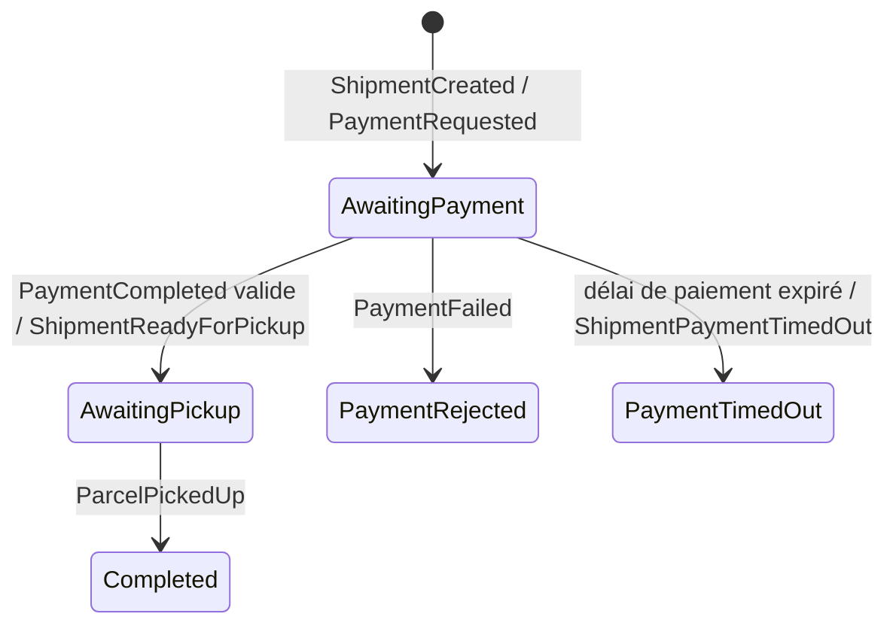

# Shipment Service — étape 3

## Périmètre livré

Création d'un envoi à un colis, devis calculé côté serveur, suivi unique et étiquette PDF A6 avec code-barres Code128. Le client accède uniquement à ses envois ; operator et admin peuvent consulter tous les envois et étiquettes. Seul admin modifie les tarifs.

Le propriétaire provient du sujet du JWT Keycloak validé. Le client ne peut pas imposer son identifiant propriétaire, un tarif ou un numéro de suivi. Les adresses expéditeur/destinataire sont des instantanés : une modification ultérieure du profil Customer ne réécrit pas une étiquette historique. Le lien avec Customer est le même sujet Keycloak, sans référence croisée entre les bases et sans dépendance HTTP pendant la création.

Les identifiants sont générés par le serveur. Le suivi est `PF` suivi de 24 caractères hexadécimaux majuscules, issus de 96 bits cryptographiquement aléatoires. Une contrainte unique PostgreSQL complète cette génération.

## Règles produit et tarification

- Un colis par envoi, poids réel strictement positif et au plus 30 kg, précision au gramme.
- Dimensions strictement positives et au plus 200 cm, précision au centième de centimètre.
- Poids volumétrique = longueur × largeur × hauteur / 5000, dimensions en cm.
- Poids facturable = maximum du poids réel et du poids volumétrique, au plus 30 kg avant arrondi.
- Prix EUR = base + plafond du poids facturable en kg × prix par kg ; arrondi à deux décimales.
- Tarifs à deux décimales : base entre 0 et 10 000 EUR, prix/kg strictement positif et au plus 10 000 EUR.

| Zone | Définition | Base initiale | Prix/kg initial |
|---|---|---:|---:|
| Domestic | Même pays ISO pour expéditeur et destinataire | 4,90 EUR | 1,20 EUR |
| Europe | Deux pays de la liste Europe, différents | 9,90 EUR | 2,50 EUR |
| International | Autres couples de pays | 19,90 EUR | 5,00 EUR |

La liste Europe est explicite dans `ShippingZones` : pays européens, pays transcontinentaux AM/AZ/GE/RU/TR et territoires européens AX/FO/GG/GI/IM/JE/SJ. Il s'agit d'une zone tarifaire produit, sans calcul douanier ni fiscal supplémentaire. Exemple : un colis France–France de 2,5 kg et 30 × 20 × 10 cm coûte 4,90 + 3 × 1,20 = 8,50 EUR.

La création relit le tarif courant en base ; elle ne réutilise pas une valeur de devis envoyée par le client. Une mise à jour administrative entre devis et création peut donc modifier le prix final. Le prix, la zone, les adresses et les mesures sont ensuite conservés sur l'envoi. Redis sert uniquement la liste indicative des tarifs pendant 60 secondes avec invalidation après écriture ; le calcul financier lit PostgreSQL.

Les trois tarifs de référence sont installés par migration, même sans seed de démonstration. Une nouvelle exécution des migrations ne remet pas les prix administratifs à leur valeur initiale.

## API et droits

Toutes les routes métier exigent un JWT d'audience `shipment-api`, avec un sujet et un rôle customer/operator/admin. L'identité provient de Keycloak ; aucun compte ou mot de passe n'est stocké dans Shipment.

| Méthode | Route | Droits et résultat |
|---|---|---|
| POST | `/api/v1/shipments/quote` | Utilisateur connecté ; devis |
| POST | `/api/v1/shipments` | Utilisateur connecté ; création de son envoi, 201 |
| GET | `/api/v1/shipments?offset=0&limit=20` | Ses envois ; tous pour staff, limite 1–100 |
| GET | `/api/v1/shipments/{id}` | Propriétaire ou staff |
| GET | `/api/v1/shipments/{id}/label` | Même contrôle ; PDF téléchargeable |
| GET | `/api/v1/tariffs` | Utilisateur connecté |
| PUT | `/api/v1/tariffs/{zone}` | Admin ; modification des deux montants |
| GET | `/health/live` | Vie du processus |
| GET | `/health/ready` | PostgreSQL, Redis et bus |
| GET | `/metrics` | Scraping Prometheus, sans JWT |

Le corps de quote/create contient `sender`, `recipient`, `parcel`. Chaque adresse contient name, email, phone, line1, line2 facultative, postalCode, city, countryCode ISO alpha-2 majuscule. Le colis contient weightKg, lengthCm, widthCm, heightCm. Les contrôles rejettent les caractères de contrôle, adresses email invalides et précisions non représentables en base. Les propriétés ownerSubject/price non prévues dans ce corps ne déterminent jamais les données enregistrées.

Les erreurs suivent ProblemDetails avec traceId : validation 400, accès anonyme/invalide 401, accès interdit 403, absent 404, conflit d'unicité/concurrence 409. Swagger est actif uniquement en Development. Les endpoints de supervision seront restreints au réseau de supervision lors du déploiement.

## PDF et code-barres

Le PDF vectoriel A6 est généré en C# avec les API de base .NET, sans bibliothèque PDF ou code-barres supplémentaire. Il contient les adresses postales, téléphones, poids/dimensions, zone, suivi lisible et Code128-B avec checksum et zones de silence. Une police Noto Sans embarquée, sous SIL OFL 1.1, conserve notamment les accents latins et le texte grec/cyrillique ; la table ToUnicode permet l'extraction du texte.

Une pré-génération a lieu avant toute écriture métier : un caractère absent de la police ou une adresse trop longue pour rester lisible sur A6 produit 400, sans envoi ni paiement à traiter. L'utilisateur doit alors fournir une transcription postale compatible ou une adresse plus compacte. L'étiquette est ensuite régénérée à la demande à partir de l'instantané enregistré. Elle rappelle que la prise en charge attend la confirmation du paiement.

Trois étiquettes ont été rendues et inspectées : adresse française accentuée, adresse longue et adresse cyrillique. Un décodeur ZXing indépendant a relu exactement le suivi des trois images. La licence de la police et la provenance des motifs standard sont dans Infrastructure/Labels.

## Saga persistée et événements



La saga réside dans la base Shipment et corrèle les messages par ShipmentId. ShipmentCreated a CorrelationId=ShipmentId, corrélation racine du flux ; PaymentRequested, ShipmentReadyForPickup et ShipmentPaymentTimedOut reprennent la CorrelationId du message traité et ont un EventId dérivé de ShipmentId, donc stable si la transition est rejouée (voir [BuildingBlocks](building-blocks.md#identité-des-messages-et-corrélation-14)). PaymentRequested est une commande envoyée à la file durable `billing-payments` : elle attend Billing même si son consommateur est arrêté ou pas encore démarré. Billing devra utiliser ce nom de file. Les faits ShipmentCreated et ShipmentReadyForPickup restent publiés comme événements. Elle compare montant et devise attendus avant d'accepter le paiement : un PaymentCompleted incohérent est ignoré, journalisé en avertissement (ShipmentId, EventId, devises attendue/reçue, indicateur de concordance du montant, sans montant ni donnée client) et la saga reste en AwaitingPayment. Les activités modifient l'agrégat dans le même contexte/transaction EF que l'état de saga et l'Outbox. L'Inbox MassTransit déduplique les livraisons ; les états terminaux restent conservés pour qu'une création rejouée ne redemande pas de paiement. Les événements répétés et incompatibles avec l'état courant ne refont pas les transitions.

Délai de paiement : à la création, la saga planifie un message interne `ShipmentPaymentTimeoutExpired` après `ShipmentBooking:PaymentTimeout` (30 minutes par défaut, format TimeSpan, strictement positif et au plus 2^32−1 ms, soit `49.17:02:47.295` environ 49,7 jours, limite du plugin RabbitMQ de livraison différée au-delà de laquelle le message serait routé immédiatement ; validé au démarrage). Sans paiement valide à l'échéance, la saga passe dans l'état terminal PaymentTimedOut, l'envoi passe en PaymentFailed et l'événement ShipmentPaymentTimedOut est publié via l'Outbox. Un paiement valide ou un PaymentFailed annule la planification : le jeton est effacé de la saga, ce qui neutralise le message différé encore livré par le broker. Un PaymentCompleted reçu après l'expiration ne rouvre pas l'envoi ; il est journalisé en avertissement pour revue manuelle ou remboursement. La planification utilise la livraison différée RabbitMQ : le broker doit activer le plugin `rabbitmq_delayed_message_exchange` (les tests d'intégration l'installent dans le conteneur après contrôle SHA-256). Les sagas déjà en AwaitingPayment avant la migration `AddPaymentTimeoutToken` n'ont pas de délai planifié.

États de l'agrégat : AwaitingPayment, ReadyForPickup, PaymentFailed, PickedUp. Ce ne sont pas l'historique public de suivi, qui appartient à Tracking à l'étape suivante. Les événements sortants ne contiennent pas d'adresse ou de téléphone.

Contrats partagés :

- Shipment.V1 : ShipmentCreated, ShipmentReadyForPickup, ShipmentPaymentTimedOut, ParcelPickedUp.
- Billing.V1 : PaymentRequested, PaymentCompleted, PaymentFailed.

Billing produira les résultats de paiement et Warehouse produira la prise en charge à leurs étapes. Les tests de cette étape utilisent RabbitMQ réel pour exercer ces échanges sans ajouter de faux service à l'application.

## Persistance et exploitation

Base indépendante `parcelflow_shipments`, tables shipments, tariffs, shipment_bookings et tables MassTransit Outbox/Inbox. Les adresses/mesures sont possédées par l'agrégat EF. `xmin` protège les mises à jour concurrentes. Les lectures PostgreSQL utilisent Polly pour les erreurs transitoires et le circuit breaker. Les secrets viennent de l'environnement. Serilog, OpenTelemetry, Prometheus et les health checks suivent les conventions Customer.

```powershell
$env:ASPNETCORE_ENVIRONMENT = 'Development'
$env:ASPNETCORE_URLS = 'http://localhost:5102'
$env:ConnectionStrings__ShipmentDatabase = Read-Host 'Connexion PostgreSQL Shipment, mot de passe inclus'
$env:ConnectionStrings__Redis = Read-Host 'Connexion Redis'
$env:RabbitMq__Host = Read-Host 'Hôte RabbitMQ'
$env:RabbitMq__Username = Read-Host 'Utilisateur RabbitMQ'
$env:RabbitMq__Password = Read-Host 'Mot de passe RabbitMQ'
$env:Database__Initialize = 'true'
dotnet run --project src/Services/Shipment/ParcelFlow.Shipment.Api
```

Hors Development, appliquer les migrations explicitement avant le démarrage :

```powershell
dotnet tool restore
dotnet ef database update --project src/Services/Shipment/ParcelFlow.Shipment.Infrastructure
dotnet run --project src/Services/Shipment/ParcelFlow.Shipment.Api
```

La factory EF lit `ConnectionStrings__ShipmentDatabase`. Le flag SeedDemoData n'est pas nécessaire à l'installation des tarifs de référence. Aucun faux envoi n'est automatiquement injecté dans le flux de paiement. Keycloak et les dépendances partagées, ainsi que Dockerfiles/Compose, restent livrés à l'étape Docker prévue.

## Travail parallèle et validation

Trois agents ont possédé des fichiers distincts : Domain/Application/unitaires, API/tests HTTP, Infrastructure/Saga/migrations/tests de persistance. Le parent a fourni contrats, PDF/code-barres, vérification visuelle et intégration. Les interfaces ont été fixées avant l'implémentation ; les compilations, migrations et l'intégration finale ont été coordonnées. Une revue croisée a identifié puis fait corriger le bootstrap des tarifs, la validation email et les claims JWT mal formés.

Les tests comprennent invariants et précision, calcul du prix, isolation propriétaire/staff, contrats JSON, Code128, structure PDF, JWT, migrations, unicité, concurrence, rollback Outbox et parcours saga avec redélivrances et états terminaux. Les tests d'intégration exigent Docker et utilisent PostgreSQL, RabbitMQ et Redis via Testcontainers.

```powershell
dotnet build ParcelFlow.sln --configuration Release
dotnet test ParcelFlow.sln --configuration Release --no-build
```

## Résultat vérifié

Compilation Release .NET 8 : zéro avertissement et zéro erreur. Suite monorepo : 145 tests réussis, aucun ignoré, dont 51 unitaires Shipment, 8 contrats/étiquettes Shipment et 30 intégrations Shipment. Les 56 tests du socle et de Customer restent réussis. Aucune dérive entre modèle EF et migrations ; aucun package vulnérable connu signalé par NuGet avec dépendances transitives incluses. Trois rendus PDF et trois décodages indépendants du suivi ont été vérifiés.
