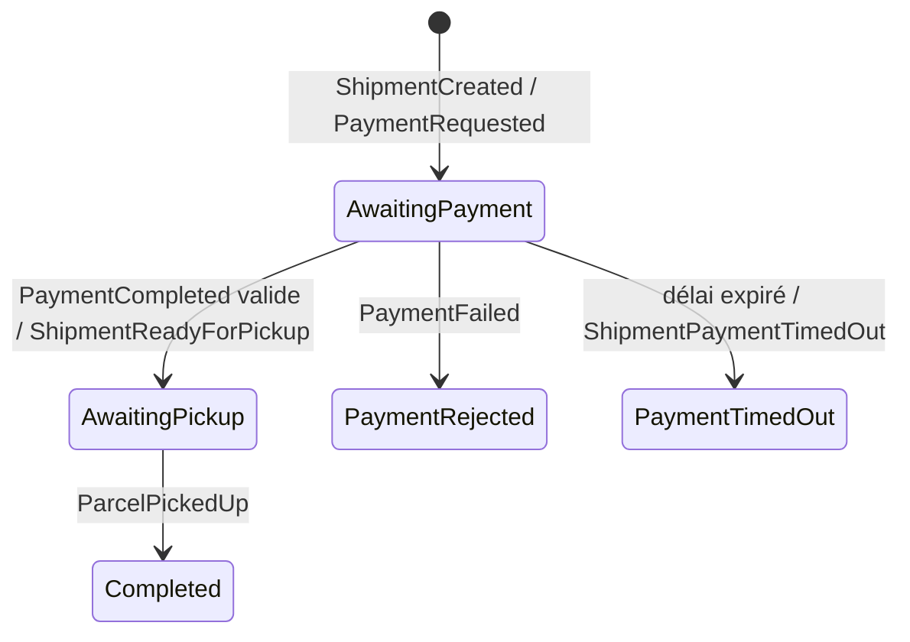

# Chapitre 3 — Shipment : tarification, étiquette et saga

## Objectif

Shipment est le cœur du flux : il crée l'envoi, calcule le prix **côté serveur**, génère une étiquette PDF et pilote, par une **saga persistée**, l'enchaînement paiement → prise en charge. C'est ici qu'apparaissent les contrats inter-services (`Shipment.V1`, `Billing.V1`) consommés par les chapitres suivants.

Le gabarit du chapitre 2 est repris tel quel (quatre projets, Outbox, Polly, JWT). Ce chapitre ne détaille que ce qui est nouveau.

## Étape 1 — Le domaine : un prix que le client ne peut pas imposer

Règles de `Domain/Entities.cs` : un colis par envoi, 30 kg maximum, poids facturable = max(poids réel, volume / 5000).

```csharp
public decimal BillableWeightKg => Math.Max(WeightKg, LengthCm * WidthCm * HeightCm / 5000m);

public decimal CalculatePrice(ParcelSpecification parcel) =>
    decimal.Round(BasePrice + decimal.Ceiling(parcel.BillableWeightKg) * PricePerKg, 2, MidpointRounding.AwayFromZero);
```

La zone (Domestic / Europe / International) est déduite des codes pays par `ShippingZones.Resolve`, avec une liste Europe explicite.

> **Décision :** la création relit le tarif courant en base et ne réutilise jamais le prix d'un devis envoyé par le client. Le propriétaire vient du `sub` du JWT, jamais du corps de la requête. Exemple vérifiable : France → France, 2,5 kg, 30 × 20 × 10 cm = 4,90 + 3 × 1,20 = **8,50 EUR**.

Les trois tarifs de référence sont posés par une **migration** (`SeedShipmentTariffs`), pas par un seed de démonstration : ils existent aussi en production.

## Étape 2 — Numéro de suivi et étiquette PDF sans dépendance

`Infrastructure/Labels/TrackingNumberGenerator.cs` :

```csharp
public string Generate() => "PF" + Convert.ToHexString(RandomNumberGenerator.GetBytes(12));
```

96 bits aléatoires cryptographiques, complétés par une contrainte unique PostgreSQL.

L'étiquette A6 (`Labels/ShippingLabelGenerator.cs`, `Code128Barcode.cs`, `LabelFont.cs`) est un PDF vectoriel écrit avec les API de base .NET, code-barres Code128-B et police Noto Sans embarquée (accents, grec, cyrillique).

> **Pourquoi ne pas utiliser une bibliothèque PDF ?** Le besoin est étroit (une page, un code-barres) et une dépendance de plus est une surface de licence et de vulnérabilités. Le PDF est **pré-généré avant toute écriture** : une adresse impossible à imprimer donne 400 avant la création de l'envoi. Les rendus ont été vérifiés avec un décodeur ZXing indépendant.

## Étape 3 — Les contrats partagés

Ajoutés dans BuildingBlocks (`Contracts/Shipment/V1`, `Contracts/Billing/V1`) :

- `ShipmentCreated`, `ShipmentReadyForPickup`, `ShipmentPaymentTimedOut`, `ParcelPickedUp`
- `PaymentRequested`, `PaymentCompleted`, `PaymentFailed`

Billing et Warehouse n'existent pas encore : les tests de cette étape publient ces messages directement sur un RabbitMQ réel, sans faux service dans l'application.

## Étape 4 — La saga de réservation



`Infrastructure/Booking/ShipmentBookingStateMachine.cs` (MassTransit) :

```csharp
Initially(When(Created)
    .Then(context => { context.Saga.TrackingNumber = context.Message.TrackingNumber; /* montant, devise */ })
    .Send(new Uri("queue:billing-payments"), context => new PaymentRequested(
        DeterministicGuid.Create("shipment:payment-requested:", context.Message.ShipmentId), context.Message.CorrelationId,
        DateTimeOffset.UtcNow, context.Message.ShipmentId, context.Message.CustomerSubject,
        context.Message.Amount, context.Message.Currency))
    .Schedule(PaymentTimeout, context => new ShipmentPaymentTimeoutExpired(context.Message.ShipmentId,
        context.Message.CorrelationId))
    .TransitionTo(AwaitingPayment));
```

Points de conception :

- **Commande vers une file durable nommée** (`queue:billing-payments`), pas un événement publié : le message attend Billing même si celui-ci n'a jamais démarré.
- **Garde sur le montant et la devise** : un `PaymentCompleted` incohérent est ignoré et journalisé, la saga continue d'attendre.

  ```csharp
  When(Paid, context => context.Message.Amount == context.Saga.Amount &&
          context.Message.Currency == context.Saga.Currency)
      .Unschedule(PaymentTimeout)
      .Activity(value => value.OfType<PaymentCompletedActivity>())
      .Publish(/* ShipmentReadyForPickup */)
      .TransitionTo(AwaitingPickup),
  ```

- **États terminaux conservés** (`PaymentRejected`, `PaymentTimedOut`, `Completed`) avec `Ignore(...)` explicites : un `ShipmentCreated` rejoué ne redemande jamais de paiement.
- **Activités** (`Booking/ShipmentActivities.cs`) : elles modifient l'agrégat `ParcelShipment` dans le **même DbContext et la même transaction** que l'état de saga et l'Outbox.

Enregistrement (`Infrastructure/DependencyInjection.cs`) :

```csharp
bus.AddDelayedMessageScheduler();
bus.AddSagaStateMachine<ShipmentBookingStateMachine, ShipmentBookingState>()
    .EntityFrameworkRepository(repository =>
    {
        repository.ConcurrencyMode = ConcurrencyMode.Optimistic;
        repository.ExistingDbContext<ShipmentDbContext>();
        repository.UsePostgres();
    });
bus.AddConfigureEndpointsCallback((context, _, endpoint) =>
{
    endpoint.UseMessageRetry(retry => retry.Interval(3, TimeSpan.FromMilliseconds(200)));
    endpoint.UseEntityFrameworkOutbox<ShipmentDbContext>(context);
});
// ...
rabbit.UseDelayedMessageScheduler();
```

## Étape 5 — Le délai de paiement (ajouté par #38)

Le délai a été introduit après audit (ticket #13, PR #38) : sans lui, un envoi impayé restait en attente indéfiniment. La saga planifie `ShipmentPaymentTimeoutExpired` après `ShipmentBooking:PaymentTimeout` (30 min par défaut, validé au démarrage). Le jeton de planification est stocké dans la saga (migration `AddPaymentTimeoutToken`) : après un paiement, `Unschedule` l'efface et un message différé encore en vol devient sans effet.

> **Conséquence d'infrastructure :** la planification utilise la livraison différée RabbitMQ, donc le plugin `rabbitmq_delayed_message_exchange`. Les tests l'installent dans leur conteneur après contrôle SHA-256 (`tests/Shared/RabbitMqDelayedExchange.cs`), et le chapitre 10 construit une image RabbitMQ qui l'embarque.

```csharp
return configure(new RabbitMqBuilder("rabbitmq:3.13-management-alpine"))
    .WithResourceMapping(plugin, $"/opt/rabbitmq/plugins/{PluginFile}")
    .WithResourceMapping(Encoding.ASCII.GetBytes(EnabledPlugins), "/etc/rabbitmq/enabled_plugins")
    .Build();
```

## Organisation du travail

Trois lots parallèles sur des fichiers distincts, après fixation des interfaces : Domain/Application/unitaires ; API/tests HTTP ; Infrastructure/saga/migrations/persistance. Contrats, PDF, intégration et revue croisée sont restés au niveau du coordinateur.

## Décisions et compromis

| Choix | Compromis accepté |
| --- | --- |
| Adresses copiées dans l'envoi (instantané) | Une modification du profil Customer ne réécrit pas une étiquette historique : c'est voulu |
| Pas d'appel HTTP vers Customer à la création | Shipment reste disponible si Customer est arrêté |
| Saga dans la base Shipment | Le propriétaire du flux possède son état ; pas d'orchestrateur central |
| Un `PaymentCompleted` tardif (après expiration) n'est pas rejoué | Journalisé pour revue manuelle (issue #39 ouverte côté Billing) |

## Vérifier

```powershell
dotnet test tests/Services/Shipment/ParcelFlow.Shipment.UnitTests --configuration Release
dotnet test tests/Services/Shipment/ParcelFlow.Shipment.ContractTests --configuration Release
dotnet test tests/Services/Shipment/ParcelFlow.Shipment.IntegrationTests --configuration Release   # Docker requis
```

Les tests d'intégration couvrent migrations, unicité, concurrence, rollback de l'Outbox et parcours de saga avec redélivrances, états terminaux et expiration du délai.

Référence : [docs/shipment-service.md](../shipment-service.md).

Chapitre suivant : [Tracking et Warehouse](04-tracking-et-warehouse.md).
